    [](https://battery-twin.streamlit.app/)
# Battery Digital Twin

**A hybrid physics–empirical digital twin of a lithium-ion or sodium-ion battery cell, with a techno-economic analysis and a screening life cycle assessment**

A battery cell simulator that combines a **physics model** (PyBaMM) with **empirical ageing
models fitted to published measurements**, plus techno-economic (TEA) and life-cycle (LCA)
screening, in a Streamlit dashboard. Chemistries: NMC, LFP, NCA and sodium-ion.

---

## Abstract

Simulations used to design and operate batteries have to work at two very different time
scales. Electrochemical models resolve what happens inside a cell during one charge or
discharge (seconds to hours). Battery lifetime, and so the economics and environmental
impact of a battery, depends on what happens over thousands of cycles (years). Running a
full electrochemical model over the whole service life is computationally expensive. Its
degradation mechanisms are also hard to parameterise for a specific commercial cell.

This work presents a *hybrid* digital twin that splits the problem at that boundary. A
physics-based model (the Single Particle Model with electrolyte, SPMe, or the
Doyle–Fuller–Newman model, DFN, with a lumped thermal model, core and can temperatures for the
cylindrical cells and lithium plating in the detailed NMC model, implemented in PyBaMM) simulates
the first ten cycles of a user-defined test in full. From those cycles it takes the operating
conditions that drive ageing: state-of-charge trajectory, depth of discharge, charge and
discharge rates, and cell temperature. These conditions drive empirical capacity-fade models,
one per chemistry. The models come from the NREL BLAST-Lite library and were refitted or
rescaled to 46 points read from peer-reviewed ageing studies (Preger et al. 2020; Wittman et
al. 2023; Luh & Blank 2024; Ohneseit et al. 2025), to 81 cells from Severson et al. (2019) and
to two Samsung 50E cells (REBELION).
They project capacity fade over up to 20,000 cycles. The NMC physics model is also calibrated
against measured LG M50T data (Kirkaldy et al. 2024): lithium-inventory loss is reproduced
within 0.40 %-points (RMSE) on the training cells, and 2.56 %-points on held-out cells at
10 °C; with one electrolyte factor fitted to 2–3C discharges of the same cell (Catenaro &
Onori 2021) it reproduces their capacity within 0.07 Ah and their surface temperature within
3.8 K (RMS) from 1C to 5C at 25–35 °C. The NCA physics matches the capacity and the 0.75C
warming of two Samsung 50E cells, and the NCA ageing model is scaled to two 50E cells cycled
for 530 full cycles (REBELION). The LFP model has a late capacity drop (knee) under fast
charging, fitted to Severson's cycle-by-cycle curves.

The projected capacity curve feeds two downstream assessments:

1. A cycle-by-cycle techno-economic analysis of energy arbitrage on the Portuguese
   day-ahead market (hourly OMIE prices): net present value (NPV), internal rate of return
   (IRR), discounted payback, levelised cost of storage (LCOS), and second-life value. It
   follows the framework of ISO/TS 14076:2025 (environmental techno-economic assessment)
   and the life-cycle costing structure of IEC 60300-3-3 and ISO 15686-5. Costs come from
   NREL, Benchmark Mineral Intelligence and Lazard, grid fees from ERSE, income tax from the
   2026 State Budget, and the discount rate from Steffen (2020).
2. A screening life cycle assessment that follows ISO 14040/14044 (not critically reviewed).
   It uses the functional unit of the EU Battery Regulation (EU) 2023/1542 and the JRC rules
   for the carbon footprint of industrial batteries (CFB-IND). Production impacts come from
   Degen et al. (2024): climate change, water consumption and freshwater ecotoxicity under
   ReCiPe 2016.

The dashboard exports ISO-structured LCA and TEA reports (PDF or Word). At the default
settings (20 °C, 0.3C charge, 1C discharge, one cycle per day), the model predicts 376
cycles to 80 % capacity for NMC, 1,227 for LFP, 884 for NCA and 401 for sodium-ion (at the
default fade rate measured on commercial layered-oxide cells). That is consistent with the
roughly three-fold LFP-to-NMC ratio measured in a single study under identical protocols
(Ohneseit et al. 2025).

The twin then follows a battery electric vehicle (BEV) battery through two lives: daily
driving and charging (with a share of DC fast charges) for a set number of years, checked
against the Euro 7 durability limits, then reuse as stationary storage from the capacity it
left the car with, priced with the NREL B2U repurposing calculator and compared with a new
LFP storage system. The car life is checked against field data: the laboratory NMC model
loses about three times what six Smart e.d. cars lost (Rücker et al. 2024), so its calendar
and cycling losses are scaled by 0.56 and 0.22; with these factors it reproduces, without
refitting, a VW ID.3 test car (94.3 vs 98.0 %) and the ID.3 cell's laboratory highway test
with about 1,100 fast charges (94.1 vs 92.2 %; Schreiber et al. 2025). The unscaled LFP model
matches a Tesla Model 3 after 79,100 km (91.4–94.4 vs 91.9 %; Bilfinger et al. 2025), and the
storage model matches the yearly capacity loss of 21 home storage systems (Figgener et al.
2024). At the defaults, a car battery leaves the car after 8 years and 146,000 km with
88.9 % (LFP) and 89.6 % (NMC) of its capacity; over 8 years of storage at 80 % depth its
second life is €275 better (NMC) and €284 worse (LFP) than a new LFP system bought the same
year, a close call that the used battery's price decides, and shared over both lives its
production footprint per kWh delivered (21–22 g CO₂eq) is below that of a new LFP system
(25 g). An extended Kalman
filter with capacity estimation between relaxed rests shows what a battery management system
would estimate on the simulated cycles: SOC within 2 %-points and SOH within about
2 %-points, for every chemistry and age, and with its hysteresis term 7.6 instead of 22
points on partial LFP cycles. On a year of a real home storage system (Figgener et al. 2024)
it follows each day within 2.3 points (median RMS) from a wrong start, and its rest-to-rest
capacity agrees with the capacity counted from empty to full within 2 %. On a real car (the
TUM Tesla Model 3, LFP, charged in 2021 and after 80,100 km in 2025) it tracks the SOC within 3.1 %-points (RMS) from a wrong
start without knowing the 9 % capacity loss, where counting the charge with the old capacity
ends 8.7 points off.

**Keywords:** digital twin; lithium-ion battery; PyBaMM; capacity fade; lithium plating;
empirical ageing model; electric vehicle; second life; field data; state of charge;
Kalman filter; techno-economic analysis; life cycle assessment; ISO 14044;
Battery Regulation (EU) 2023/1542.

---

## Table of contents

1. [Introduction](#1-introduction)
2. [Quick start](#2-quick-start)
3. [System architecture: how it works](#3-system-architecture-how-it-works)
4. [Electrochemical and thermal model (physics)](#4-electrochemical-and-thermal-model-physics)
5. [Calibration of the NMC physics model](#5-calibration-of-the-nmc-physics-model)
6. [Empirical ageing models](#6-empirical-ageing-models)
7. [Techno-economic analysis (money)](#7-techno-economic-analysis-money)
8. [Screening life cycle assessment (environment)](#8-screening-life-cycle-assessment-environment)
9. [Results at the default settings](#9-results-at-the-default-settings)
10. [Validation and known limitations](#10-validation-and-known-limitations)
11. [Software implementation, testing and reproducibility](#11-software-implementation-testing-and-reproducibility)
12. [Conclusions and future work](#12-conclusions-and-future-work)
13. [Development](#13-development)
14. [Licences and credits](#14-licences-and-credits)
15. [References](#15-references)
- [Appendix A: Nomenclature](#appendix-a-nomenclature)

---

## 1. Introduction

### 1.1 Motivation

How a battery is used, from the C-rates it charges and discharges at to the temperature it
works at, the cooling it gets and how often it cycles, sets how quickly it loses capacity.
That loss sets three things that matter outside the laboratory:

- **Service life:** how many cycles or years the battery stays above a useful capacity.
- **Economics:** how much energy, and so revenue, the battery delivers before it is retired.
- **Environmental impact per unit of service:** production impacts are fixed when the
  battery is made, so every kWh the battery delivers carries a share of them. A battery that
  lasts twice as long halves its production impact per kWh delivered. This is why the EU
  Battery Regulation (EU) 2023/1542 defines the carbon footprint per kWh of energy delivered
  over the service life, not per kWh of capacity.

A *digital twin* here means a computational model of a battery cell that responds to the
same operating inputs as the real cell and predicts its electrical, thermal and ageing
behaviour and, from those, its economic and environmental performance.

### 1.2 Problem statement

Two families of models exist, each with a weakness for this purpose:

| Approach | Strength | Weakness for lifetime studies |
|---|---|---|
| Physics-based (pseudo-two-dimensional DFN, SPMe) | Resolves voltage, current, heat and internal states from first principles | Expensive to integrate over thousands of cycles. Degradation sub-models (SEI growth, lithium plating, particle cracking) have many parameters that are rarely published for a given commercial cell |
| Empirical / semi-empirical ageing models | Fast; fitted directly to measured capacity fade of commercial cells | Need the operating conditions (SOC swing, temperature, C-rate) as input; know nothing about voltage or heat |

### 1.3 Objectives

1. Simulate a user-defined cycling test of a commercial-type cell (NMC, LFP, NCA or
   sodium-ion) with a physics model, including self-heating under a chosen cooling option.
2. Predict long-term capacity fade with empirical models that are fitted or checked against
   peer-reviewed measurements, including charge-rate and temperature effects (lithium plating).
3. Translate the capacity trajectory into economic indicators (NPV, IRR, payback, LCOS) for
   an energy-arbitrage application, including second life.
4. Translate the same trajectory into life cycle impact indicators per functional unit, and
   export a screening LCA report that follows the structure of ISO 14040/14044.
5. Follow a car battery through two lives: daily driving and (fast) charging in a battery
   electric vehicle, checked against the Euro 7 durability limits, then reuse as stationary
   storage, compared with a new LFP system on cost and carbon.
6. Check the ageing models against field data from cars and home storage systems, not only
   against laboratory cells.
7. Estimate the state of charge and state of health from current and voltage, as a battery
   management system would.
8. State the validity range of every model openly: warn the user when the inputs leave the
   measured conditions, and document where the models are known to be inaccurate.

### 1.4 Scope

- **Level:** single cell, scaled to a pack by energy (the number of cells is the pack energy
  divided by the simulated cell energy). Cell-to-cell variation is not modelled; the battery
  management system only as an SOC/SOH estimator on the simulated cycles (Section 4.8). The temperature spread along one coolant channel is shown as a
  side calculation (Section 4.7); it does not change the economics or the LCA.
- **Ageing mode:** capacity fade. Resistance growth is used only to approximate an aged cell
  in the Physics tab (Section 4.6).
- **Chemistries:** NMC/graphite, LFP/graphite, NCA/graphite, sodium-ion (hard carbon / layered oxide NFM, commercial Mushang NA18650-1250).
- **Range:** capacity down to 50 % of the initial value, where the ageing data end.
- **Applications:** a stationary battery for energy arbitrage, and a car battery (first life)
  reused as stationary storage (second life).

### 1.5 Contributions

- A coupling scheme in which the physics model supplies the stress factors for empirical
  ageing models. The BLAST-Lite trajectories are evaluated in closed form, so 20,000 cycles
  are projected in milliseconds.
- Refitted cycling terms for NCA and NMC, the NCA term scaled to the physics model's own cell
  (Samsung 50E), and a rescaled LFP term with a fast-charge factor, all traceable to data in
  `src/battery_twin/data/` and reproducible with one script (`scripts/fit_ageing.py`).
- An NMC lithium-plating term that makes cooling and pre-conditioning matter for lifetime,
  and lithium plating in the detailed physics model, checked against the same cold and
  fast-charge tests.
- An LFP knee fitted to 81 cells' cycle-by-cycle capacity, tied to fast-charge wear.
- A calibration of the NMC physics model against an open dataset, with a held-out test.
- An LCA in which the functional unit (kWh delivered) is computed from the *simulated*
  ageing curve, following the CFB-IND rules, and exported as an ISO-structured report (PDF or
  Word).
- A car-to-storage life cycle in which each ageing mechanism (calendar, cycling) continues
  from where the car left it, with the repurposing cost from the NREL B2U calculator, a
  sensitivity of the second-life verdict, and its carbon footprint shared over both lives or
  cut off (Section 7.4).
- Field checks of the ageing models (Section 9): NMC factors fitted to a car fleet (Rücker et
  al. 2024) and confirmed on a VW ID.3 car and the ID.3 cell's fast-charging test (Schreiber et
  al. 2025); the LFP model against a Tesla Model 3 (Bilfinger et al. 2025); the storage model
  against 21 home storage systems (Figgener et al. 2024). All in `scripts/fit_field_ageing.py`.
- An SOC/SOH estimator (extended Kalman filter with LFP hysteresis, capacity between relaxed
  rests) scored against the simulated truth for every chemistry and age, on partial LFP cycles,
  on a real car and on a year of a real home storage system.
- High-rate NMC physics (electrolyte transport fitted to 2–3C discharges) with core and can
  temperatures, checked against measured self-heating at 1–5C; the NCA physics checked against
  two Samsung 50E cells.

### 1.6 Structure of this document

Section 3 describes the architecture. Sections 4–8 describe each sub-model: theory, equations,
parameters and data. Section 9 gives the results at the default settings. Section 10
discusses validation and limitations. Section 11 describes the implementation and tests, and
Section 12 draws the conclusions.

---

## 2. Quick start

```
git clone <this repository>
cd <repository folder>
python -m venv .venv
.venv\Scripts\activate            # Windows   (Linux/macOS: source .venv/bin/activate)
pip install -r requirements.txt
python -m streamlit run app.py    # dashboard
pytest -q                         # tests
```

Requirements: Python ≥ 3.10 (the CI uses 3.12), PyBaMM ≥ 25.10, NumPy ≥ 2.0, pandas,
SciPy, numpy-financial, Matplotlib, ReportLab and python-docx (for the PDF and Word reports). The dashboard also
needs Streamlit and Plotly (`pip install -e .[app]`). `requirements.txt` installs everything,
including the test tools.

A hosted version runs on Streamlit Community Cloud (badge above). After changing the
dependencies in `pyproject.toml`, reboot the app there so they are reinstalled.

---

## 3. System architecture: how it works

### 3.1 Overview

Follow the arrows from top to bottom. Each box is one step, with the file that does it in italics. The dashed arrow is a step done once, not on every run.

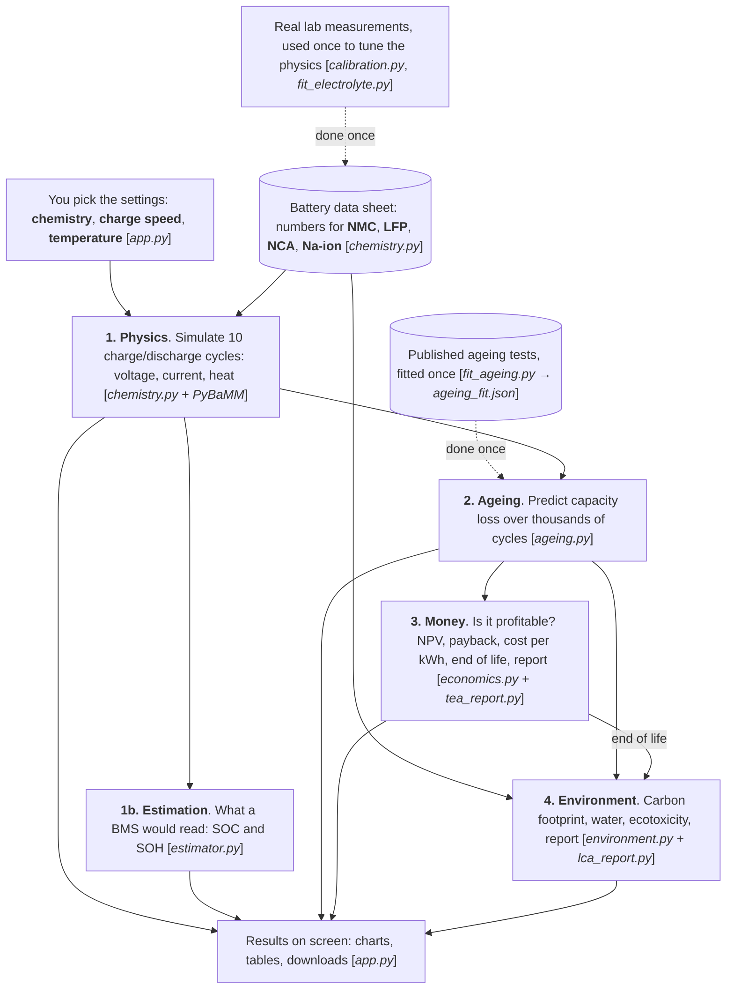

The environment step receives the ageing curve (arrow `AGE → CO2`), because the functional
unit of the LCA is the energy delivered over the service life (Section 8), and the end of
life from the economics (`MONEY → CO2`): the retirement threshold of highest NPV is the one
end of life of the run.

### 3.2 The two time scales

The key design decision is to split the simulation at the boundary between the two time
scales described in Section 1.2:

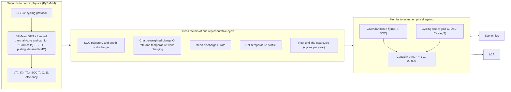

### 3.3 Sequence of one dashboard run

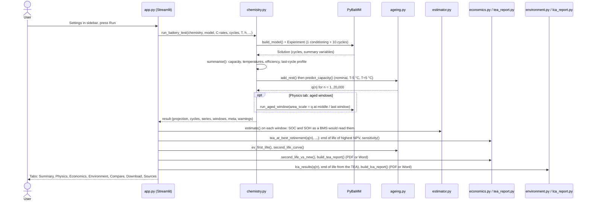

### 3.4 Module dependencies

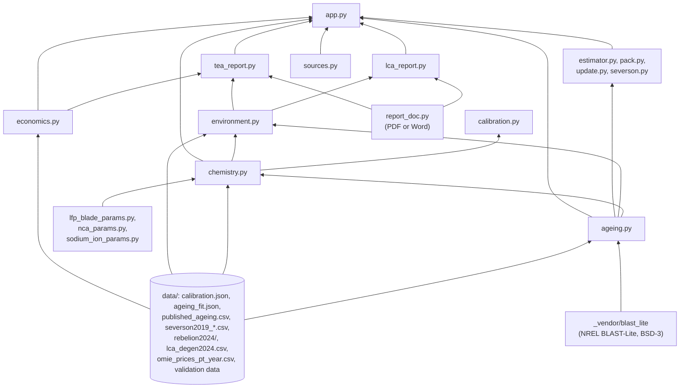

### 3.5 Dashboard

The sidebar defines the *battery test*: chemistry, charge rate
(0.3–4C), discharge rate (0.3–3C), ambient temperature (5–45 °C), cooling option, cycles per
year (12–3,650), pack size, the vehicle of the battery's first life (under "Vehicle": distance
per day, years in the car, consumption, share of DC fast charges; used by the Environment
tab's vehicle case, the Economics tab's second life and both reports) and, under "Advanced",
the detailed DFN model. The car is charged once a day at the same charge rate (or DC fast, for
the chosen share). The battery test runs for the same years at the cycles per year set above
(8 years at 365 cycles a year = 2,920 cycles). For sodium-ion it
also sets the capacity loss per cycle. The results are shown in seven tabs:

| Tab | Content |
|---|---|
| Summary | The battery's life only: capacity leaving the car (for sodium-ion a range, median to fastest-fading partial-depth cell), cells per pack, and capacity over the life in years (first life in the car, then second life in storage until its retirement threshold) |
| Physics | The battery test only (back-to-back full cycles at the sidebar rates, cycles per year × years in the car): cycles to 80 % and peak temperature, the capacity curve with the shaded sensitivity range, ageing data and validity warnings, "How accurate is this?", the update with your own measurements; voltage and temperature of the first, middle and last 10 cycles (Section 4.6); the 10 simulated cycles one by one; Coulombic and energy efficiency per cycle; SOC and SOH estimation on each window (Section 4.8) |
| Economics | NPV, IRR, payback, LCOS from hourly OMIE prices and sourced costs; cash flows by year; tornado chart (±20 %); second life; TEA report download (PDF or Word) |
| Environment | Carbon footprint (regulation scope and incl. losses), water, freshwater ecotoxicity per kWh delivered; phase table; LCA report download (PDF or Word) |
| Compare chemistries | All four chemistries on the battery test cycle (the simulated full cycle, as the Physics tab): capacity, cycles to 80 %, cost, NPV, LCOS, carbon footprint at full depth |
| Download | Capacity per cycle (CSV), voltage & temperature series (CSV), run settings (JSON) |
| Sources | Every published source and what it is used for (`src/battery_twin/sources.py`) |

---

## 4. Electrochemical and thermal model (physics)

### 4.1 Model selection

PyBaMM (Sulzer et al. 2021) solves the cell's equations for 10 full charge/discharge cycles:
voltage, current, heat and state of charge. This is accurate but slow, which is why only a few
cycles are simulated and the long term is left to the ageing models (Section 6). PyBaMM offers
two models; `chemistry.choose_model` picks one:

| Condition | Model |
|---|---|
| Default (lithium chemistries, charge ≤ 2C) | SPMe: Single Particle Model with electrolyte |
| Charge rate > 2C, discharge rate > 3C (validation scripts only; the dashboard stops at 3C), or "Detailed physics" ticked | DFN: Doyle–Fuller–Newman (pseudo-two-dimensional); for NMC with lithium plating (Section 4.4) |
| Sodium-ion (always) | DFN with the lumped thermal model and the commercial-cell parameters of Schneider et al. (2025) (`sodium_ion_params.py`); no SEI sub-model (ageing is empirical) |

The SPMe treats each electrode as one representative particle and adds an electrolyte
correction. It is accurate at low to moderate C-rates and much faster than the DFN. At high
C-rates the reaction distribution across the electrode thickness becomes non-uniform, and
the full DFN is needed.

### 4.2 Governing equations (DFN)

For each electrode *k* ∈ {n, p}, lithium diffuses in spherical active particles of radius
R_k:

```math
\frac{\partial c_{s,k}}{\partial t} = \frac{1}{r^2}\frac{\partial}{\partial r}\left(r^2 D_{s,k}\frac{\partial c_{s,k}}{\partial r}\right),
\qquad
-D_{s,k}\left.\frac{\partial c_{s,k}}{\partial r}\right|_{r=R_k} = \frac{j_k}{a_k F}
```

Lithium ions move through the electrolyte (porosity ε, transference number t⁺):

```math
\varepsilon_k \frac{\partial c_e}{\partial t} = \frac{\partial}{\partial x}\left(D_e^{\text{eff}} \frac{\partial c_e}{\partial x}\right) + \frac{(1-t^+)}{F}\, j_k
```

Charge is conserved in the solid (φ_s) and the electrolyte (φ_e):

```math
\frac{\partial}{\partial x}\left(\sigma_k^{\text{eff}}\frac{\partial \phi_s}{\partial x}\right) = j_k,
\qquad
\frac{\partial}{\partial x}\left(\kappa^{\text{eff}}\frac{\partial \phi_e}{\partial x} - \frac{2\kappa^{\text{eff}} R T}{F}(1-t^+)\frac{\partial \ln c_e}{\partial x}\right) = -j_k
```

The interfacial current density follows Butler–Volmer kinetics:

```math
j_k = a_k\, j_{0,k} \sinh\!\left(\frac{F\,\eta_k}{2RT}\right),
\qquad
\eta_k = \phi_s - \phi_e - U_k(c_{s,k}^{\text{surf}}),
\qquad
j_{0,k} = k_k \sqrt{c_e\, c_{s,k}^{\text{surf}}\,(c_{s,k}^{\max} - c_{s,k}^{\text{surf}})}
```

The terminal voltage is V = φ_s(x = L) − φ_s(x = 0). The SPMe replaces the through-thickness
solid problem with one particle per electrode and keeps a first-order electrolyte correction.

### 4.3 Thermal model

All lithium models use PyBaMM's **lumped** thermal option: one cell temperature T (two for
the 21700 cells, below), governed by an energy balance of heat generation and convective
cooling:

```math
\rho c_p^{\text{eff}} V_{\text{cell}} \frac{dT}{dt} = Q_{\text{gen}} - h\,A_{\text{cool}}\,(T - T_{\text{amb}})
```

Q_gen contains the irreversible (ohmic and reaction overpotential) and reversible (entropic)
heat; the NCA parameter set has no entropy coefficients, so its reversible heat is zero
(Section 10.1). *h* is the **total heat transfer coefficient**, an effective value over the whole
cooling surface A_cool. It is set by the cooling option (Section 4.5). The sodium-ion model
uses the same lumped thermal model; its solid diffusivities and reaction rates follow
Arrhenius laws with state-of-charge-dependent activation energies (31–138 kJ/mol) and its
electrolyte conductivity a Vogel–Tammann–Fulcher law (Schneider et al. 2025), so a warmer cell
has lower losses.

**Core and can (NMC and NCA, 21700 cells).** In a cylindrical cell the heat must cross the
jelly roll before it reaches the can, so the inside runs warmer than the surface, more so the
better the cooling (Lin et al. 2014). The two 21700 cells therefore have two temperatures
(PyBaMM's lumped surface-temperature option): the core (the cell average, which drives the
reactions and the ageing model) and the can, which *h* cools:

```math
C_{\text{core}} \frac{dT}{dt} = Q_{\text{gen}} - \frac{T - T_{\text{can}}}{R_{\text{core}}},
\qquad
C_{\text{can}} \frac{dT_{\text{can}}}{dt} = \frac{T - T_{\text{can}}}{R_{\text{core}}} - h\,A_{\text{cool}}\,(T_{\text{can}} - T_{\text{amb}})
```

R_core = 1 / (8π k L) = 3.1 K/W is the mean-to-surface resistance of a cylinder heated evenly,
with the radial conductivity of cylindrical cells, k = 0.20 W/mK (Drake et al. 2014), and
L = 0.065 m; C_can = 3 J/K (about 6 g of steel, assumed). At the Kirkaldy chamber's h the core
is about 5 K above the can at the end of a 2C discharge; with immersion cooling (300 W/m²K)
nearly all of the rise is inside the cell. LFP (a thin prismatic cell, 0.03 K/W through its
thickness) and sodium-ion keep one temperature.

**High-rate electrolyte transport (NMC).** With Chen 2020's electrolyte (Nyman et al. 2008,
LiPF₆ in EC:EMC; the M50's own electrolyte is not published) the salt runs out near the
positive current collector at 3C, and the model stopped after 0.25 Ah (SPMe) or 2.5 Ah (DFN)
where the cell delivers 4.4 Ah. The electrolyte diffusivity is multiplied by 2, fitted to the
measured 2C and 3C capacities in the 25 and 35 °C chambers (`scripts/fit_electrolyte.py`;
RMS error 0.04 Ah, against 1.3 Ah unchanged). Above 2 the capacity barely changes, so 2 is the
smallest factor that removes the depletion. Discharges above 3C use the DFN (SPMe still stops
early at 5C).

**Check against measurements (NMC)** (`scripts/validate_thermal.py`, data in
`data/catenaro2021`): six LG M50 cells, the cell of the NMC model, charged at 0.3C and
discharged at 1–5C in a 5, 25 or 35 °C chamber (Catenaro & Onori 2021). The cells sat in a
cylindrical holder, so h is fitted once, to the 25 °C, 1C rise of the can (13.9 W/m²K), and
everything else is a prediction. Can temperature rise over the discharge (at 5C, up to the
charge at which the tester stopped at its 75 °C limit), mean of six cells (spread in
brackets); discharged capacity to 2.5 V; round-trip energy efficiency (0.3C charge):

| Chamber, discharge | Rise measured [K] | Rise model [K] | Capacity measured [Ah] | Capacity model [Ah] | Efficiency measured | Efficiency model |
|---|---|---|---|---|---|---|
| 25 °C, 1C | 8.8 (±1.8) | 8.8 (fitted) | 4.76 | 4.72 | 89.0 % | 89.8 % |
| 35 °C, 1C | 8.9 (±2.7) | 7.6 | 4.68 | 4.72 | 89.7 % | 90.5 % |
| 25 °C, 2C | 22.2 (±1.0) | 22.9 | 4.57 | 4.58 | 81.4 % | 84.4 % |
| 35 °C, 2C | 17.3 (±2.2) | 20.9 | 4.53 | 4.59 | 84.3 % | 85.0 % |
| 25 °C, 3C | 36.8 (±0.8) | 39.1 | 4.45 | 4.44 | 81.3 % | 79.0 % |
| 35 °C, 3C | 29.9 (±3.4) | 36.5 | 4.37 | 4.44 | – | 79.6 % |
| 25 °C, 5C | 50.5 (±0.4) | 46.6 | (stopped) | 2.87 | – | – |
| 35 °C, 5C | 42.1 (±4.1) | 46.8 | (stopped) | 2.88 | – | – |
| 5 °C, 1C | 14.0 (±5.1) | 10.8 | 4.39 | 4.70 | – | 88.1 % |
| 5 °C, 2C | 20.5 (±6.4) | 25.5 | 4.07 | 4.57 | – | 82.8 % |
| 5 °C, 3C | 25.7 (±14.4) | 40.5 | 3.85 | 4.42 | 72.8 % | 77.5 % |

In the 25 and 35 °C chambers the can temperature is within 3.8 K RMS of the measurements from
1C to 5C (before these changes the model was 5–8 K too warm at 2C and could not discharge at
3C), the capacity within 0.07 Ah up to 3C, and the efficiency within about 3 points. The model
is still too optimistic in the cold: in the 5 °C chamber it delivers 0.3–0.6 Ah more than the
cells. Chen 2020's diffusivities and electrolyte properties have no temperature dependence;
giving them Arrhenius terms did not fix it here, because the model's self-heating then warms
the cell back up within minutes (`fit_electrolyte.py` prints the cold check). The NCA
parameter set still stops after 0.15 Ah at 3C, so the program stops with an error when a
discharge delivers less than half the cell's capacity, instead of sizing the pack on it. LFP
and sodium-ion deliver 83–84 % at 3C. The dataset's LFP and NCA cells (A123 26650, Panasonic
NCR18650B) are not the program's LFP and NCA cells, so they are not used. The NCA model is
checked against two cells of its own type (Samsung 50E) in Section 10.1.

### 4.4 Degradation inside the physics model (SEI and lithium plating)

The lithium models enable PyBaMM's *solvent-diffusion-limited* SEI growth model. The SEI
grows as solvent diffuses through the existing layer, at a rate inversely proportional to
its thickness. Its diffusivity is Arrhenius-dependent:

```math
j_{\text{SEI}} \propto -\frac{c_{\text{sol}}\, D_{\text{sol}}(T)}{L_{\text{SEI}}},
\qquad
D_{\text{sol}}(T) = D_{\text{sol,ref}} \exp\!\left[\frac{E_{\text{SEI}}}{R}\left(\frac{1}{T_{\text{ref}}} - \frac{1}{T}\right)\right]
```

The LFP set (based on Prada 2013) gives E_SEI = 0 J/mol, and the NCA set (Schmitt 2023)
has no SEI parameters (they come from Chen 2020); E_SEI = 0 J/mol would
make SEI growth independent of temperature. The program uses 38 kJ/mol from O'Kane et al.
(2022) instead. For NMC both SEI parameters are calibrated (Section 5). This physics-level
SEI loss is reported for the ten simulated cycles. The **long-term** projection uses the
empirical models of Section 6, which capture all mechanisms that the measured data contain.

**Lithium plating (detailed NMC model).** When the DFN runs for NMC (charging above 2C, or
"Detailed physics" ticked), it also has PyBaMM's partially reversible lithium plating on
graphite, with the parameters O'Kane et al. (2022) gave for the same LG M50 cell: metallic
lithium deposits when the graphite potential falls below 0 V vs Li, part of it strips back
on discharge, and part becomes dead lithium. The plating loss per cycle is shown next to the
SEI loss. `scripts/check_plating.py` runs Luh & Blank's 16 cold and fast-charge tests
(0–40 °C, 0.33–1.67C charge) for three cycles each: the plating that stays after a cycle
ranks the tests like their measured fade (Spearman 0.87, p = 10⁻⁵) and grows 20–700 times
from 40 to 0 °C; but it is about 0.2 % of the measured fade (median), and at 0 °C it does not
grow with the charge rate (0.0011, 0.0014 and 0.0010 % per cycle at 0.33, 1 and 1.67C) where
the measured life falls from 187 to 41 cycles. With O'Kane's rate constants the physics
confirms where plating happens, not how much capacity it takes, so the empirical plating term
(Section 6.4) still sets the life.

### 4.5 Parameter sets, cycling protocol and cooling

**Parameter sets.** Each chemistry uses a published PyBaMM parameter set (`chemistry.py`).
Missing parameters (for example the thermal properties of the LFP and NCA cells) are filled
from Chen 2020, without overwriting existing values:

| Chemistry | Parameter set | Cell | Voltage window | Modifications |
|---|---|---|---|---|
| NMC | Chen 2020 | LG M50 21700 (≈5 Ah) | 2.5–4.2 V | Lithium inventory, SEI diffusivity and activation energy calibrated (Section 5); electrolyte diffusivity × 2 (Catenaro & Onori 2021, Section 4.3); core and can temperatures; lithium plating (O'Kane 2022) in the DFN |
| LFP | BYD Blade (`lfp_blade_params.py`) | BYD Blade, prismatic BEV cell, 135 Ah, LFP / graphite | 2.6–3.65 V | Geometry, electrode sizes, component masses and capacity from the teardown of Gorsch et al. (2025), plus the foil resistance computed from it; electrochemistry from Prada 2013 with the graphite OCP of Mohtat et al. (2020) and temperature-dependent graphite diffusion; LFP OCP level, LFP hysteresis (PyBaMM "one-state hysteresis"), graphite kinetics and graphite diffusivity fitted to measured LFP cells, incl. the Blade's own pulse resistance (`scripts/fit_blade.py`, Section 10.1); entropy coefficient measured on a 280 Ah LFP cell (Gray & Vagg 2026, data in `data/gray2026/`); electrolyte Landesfeind & Gasteiger (2019); E_SEI = 38 kJ/mol |
| NCA | Schmitt 2023 | Samsung INR21700-50E, 21700, 4.9 Ah, NCA / graphite-SiOx | 2.5–4.2 V | OCPs, exchange current and checks read from the paper's figures (`scripts/digitize_schmitt.py`, data in `data/schmitt2023/`); thermal and SEI values from Chen 2020; E_SEI = 38 kJ/mol; core and can temperatures; no entropic heat |
| Na-ion | Schneider 2025 | Mushang NA18650-1250, 18650, 1.25 Ah, layered oxide (Na-Ni-Fe-Mn) / hard carbon | 1.5–3.8 V | None; curves read from the paper's Fig. 12 vector graphics (`scripts/extract_schneider_fig12.py`, data in `data/schneider2025/`) |

**Cycling protocol.** Each cycle is CC discharge to V_min, rest 5 min, CC charge to V_max,
CV hold at V_max until C/20, and rest 5 min. One extra conditioning cycle (cycle 0) is run
first and discarded, because the parameter set's initial state does not match the CC-CV
charged state. The capacity of each cycle is the thermodynamic capacity from PyBaMM's
electrode state-of-health summary (lithium), or the measured discharge capacity (sodium-ion).
Coulombic and energy efficiencies are integrated from the current and voltage.

**Cooling.** The sidebar offers three cooling options. Each sets an average effective heat transfer
coefficient h over the cell surface (a modelling assumption within the textbook ranges of
Incropera et al., Table 1.1; the dashboard shows a warning with the realistic range):

| Option | h (W/m²K) | Pre-conditioning |
|---|---|---|
| Forced air / passive | 25 | No: cells cycle at the ambient temperature |
| Liquid cold plate | 100 | When fast charging (≥ 1.2C): cells held at 25 °C while cycling |
| Immersion cooling | 300 | When fast charging (≥ 1.2C): cells held at 25 °C while cycling |

Between cycles the battery always rests at the ambient temperature. The calibrated value
for the Kirkaldy test chamber (12 W/m²K, cooling the can) is still the default of `run_battery_test`. All
published sources are listed in the dashboard's **Sources** tab (`src/battery_twin/sources.py`).

The textbook ranges are 2–25 W/m²K for free convection of air, 25–250 W/m²K for forced air
and 100–20,000 W/m²K for forced liquids. Those are coolant-side values, whereas the lumped
model needs an *effective* value over the whole cell surface. Only part of each cell touches
a cold plate, through a thermal interface material, so the effective values chosen are much
lower. The warnings shown in the dashboard give the realistic effective ranges: about
5–15 W/m²K (passive) and 25–50 W/m²K (forced air), 50–200 W/m²K (cold plate) and
100–1,000 W/m²K (immersion). With pre-conditioning, the thermal system warms or cools the
cells to 25 °C while they cycle, so in cold weather they do not charge cold. It runs only
when fast charging (1.2C or faster, `DC_FAST_C`, as EVs do before a DC fast charge); at
slower charging the cells cycle at the ambient temperature, as with air. Section 6.4
shows why that matters for NMC.

### 4.6 Physics tab: first, middle and last cycles

The physics model simulates the first 10 cycles in full. To compare them with later life,
the Physics tab also simulates 10 cycles in the middle and at the end of the chosen number
of cycles, using an aged cell: the new cell with its electrode area scaled to the capacity
the ageing model predicts there. It holds less charge and, at the same current, has a higher
resistance (+25 % at 80 % capacity). This is an approximation: real ageing also shifts the
electrode balance and grows the SEI, which the scaled cell does not capture.

Formally, the electrode width is multiplied by the predicted capacity fraction q(n_start).
The C-rate current is kept at the *new* cell's value, so the current density per electrode
area rises by 1/q. That reproduces a resistance increase of 1/q − 1, which is +25 % at
q = 0.8. Ohneseit et al. (2025) measured roughly +10 to +50 % ohmic resistance growth to
80 % capacity. Windows that overlap an earlier window, or that start below 50 % capacity,
are not simulated.

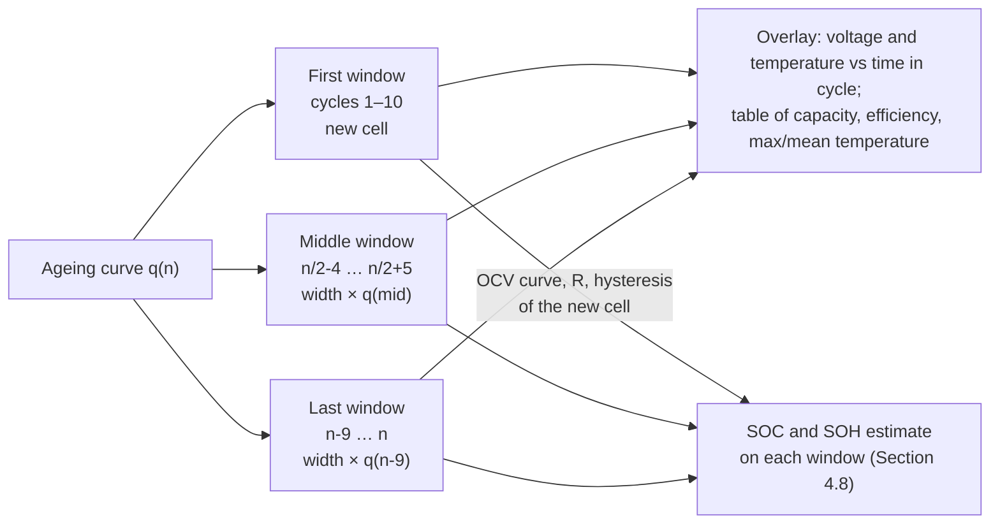

### 4.7 Pack row: cells along one coolant channel

The physics model simulates one cell in coolant at the inlet temperature. In a pack the
coolant warms as it passes each cell, so cells further along the channel run hotter. The
expander "Pack: cells along one coolant channel" in the Physics tab shows that one effect.
It uses the coolant energy balance of ThermoWeave (docs/model.md, eq. 4; MIT licence), one
channel segment per cell:

$$(\dot m c_p + H)\,T_{c,k} = \dot m c_p\,T_{c,k-1} + H\,T_k .$$

At steady state each cell passes its mean heat $Q$ to the coolant, $H(T_k - T_{c,k}) = Q$, so
$T_{c,k} = T_{c,k-1} + Q/(\dot m c_p)$. The cell's own rise above its coolant, $Q/H$, is
already in the physics model, so cell $k$ runs $k\,Q/(\dot m c_p)$ warmer than the simulated
cell while cycling; all cells rest at the ambient temperature. $Q$ is the energy charged
minus the energy discharged in the last simulated cycle, divided by the cycle time. Each cell
then gets its own ageing curve, and the row is as good as its weakest cell (cells in series,
no capacity balancing).

Twelve cells in a row (`battery_twin.pack`), default settings otherwise (20 °C, forced air,
1C discharge, one cycle a day), cycles to 80 % of the first and last cell:

| Case | Heat per cell | Coolant | Last cell warmer by | First / last cell |
|---|---|---|---|---|
| NMC, 0.3C charge | 0.34 W | air, 60 L/min | 3.5 K | 379 / 411 |
| NMC, 1C charge | 0.78 W | air, 60 L/min | 8.0 K | 249 / 322 |
| NMC, 1C charge | 0.78 W | water-glycol, 0.5 L/min | 0.3 K | 242 / 245 |
| LFP (135 Ah Blade), 1C charge | 23.3 W | air, 1,413 L/min (the dashboard's 60 L/min per 5 Ah) | 10.2 K | 1,204 / 1,187 |

With liquid cooling the spread is a fraction of a kelvin and does not matter. With slow air
it reaches several kelvin. For NMC the warmer cells then last *longer*, because charging
warmer causes less lithium plating (Section 6.4), so the inlet cell is the weakest and the
pack lasts about as long as the simulated cell. For LFP warmer cells age faster, so the last
cell is the weakest.

Not included: heat conduction between cells, cell-to-cell differences in capacity and
resistance (no measured spread is used), and balancing. Air properties are from Incropera
et al. (Table A.4); water-glycol 50 wt% at 25 °C from MEGlobal's ethylene glycol guide
(3,490 J/kg/K, 1,060 kg/m³); the flow is an assumption.

### 4.8 SOC and SOH estimation

The Physics tab also shows what a battery management system would estimate from each window
(`estimator.py`). It only sees the simulated current and voltage with sensor noise (5 mV, 1 %
of the 1C current), and knows the new cell's open-circuit voltage curve, capacity and
resistance.

- **SOC:** an extended Kalman filter (Plett 2004) with state [SOC, V₁, R₀]: the SOC is
  counted from the current, SOC ← SOC − I Δt / (3600 Q), and corrected by the voltage,
  V = OCV(SOC) + M z − R₀ I − V₁, where V₁ is the voltage of one RC element (R₁ and τ fitted
  once on the new cell; R₀ is tracked as the cell ages). It starts from a wrong guess of 50 %.
- **Hysteresis:** LFP's charge and discharge voltage curves are about 60 mV apart, which on
  its flat curve is tens of %-points of SOC. z is Plett's one-state hysteresis state: it moves
  to −1 while discharging and to +1 while charging, exponentially in the charge moved,
  dz = −γ |I| dt / (3600 Q) (z + sign I), and M is half the gap. OCV(SOC) is the middle curve;
  the curve, M and γ are fitted together on the new cell's simulated open-circuit voltage
  (least squares, a level per 2 % SOC bin plus M z, γ from 10, 30, 100). The fit finds M = 30.5 mV for the Blade (its
  model has 31.4 mV) and 5 mV for the NMC cell, whose model has no hysteresis.
- **SOH:** after every rest the cell has relaxed, so its SOC is read from the OCV curve
  (hysteresis voltage taken off; a voltage beyond either end of the curve reads as full or
  empty).
  Between two rests at least 50 % SOC apart, Q = Ah moved / SOC change, the median of all
  such pairs so far. This is the field method of Figgener et al. (2024) for home storage
  systems. SOH = Q / the new cell's capacity, and the filter uses Q from then on.
- **Truth:** every simulated cycle starts fully charged, so the true SOC is counted from the
  simulated current, cycle by cycle, with the charge that cycle's discharge delivers.

Results at the default settings (SOC error over the last 3 of the 10 cycles, RMS; SOH
estimated vs true):

| Window | NMC | LFP |
|---|---|---|
| First (new) | 0.8 points; 100.7 vs 100.0 % | 0.4 points; 99.5 vs 100.0 % |
| Middle | 1.5 points; 62.0 vs 60.2 % | 0.7 points; 74.8 vs 74.6 % |
| Last | (below the ageing data) | 0.8 points; 52.1 vs 51.8 % |

NCA and sodium-ion (new cell): 0.8 and 0.5 points; SOH 100.9 and 100.8 %. The capacity is
found within about 2 points for every chemistry and age. On these full cycles hysteresis
matters little (LFP without it: 0.8–0.9 points in the aged windows). It matters on **partial
cycles** (`scripts/validate_hysteresis.py`): the new Blade cell repeating 1C discharges to
40 %, 0.5C charges to 70 % and back, with 1-hour rests in the flat middle of the curve. From
a wrong 50 %, after the first loop, the SOC error is 7.6 points RMS (largest 12.6) with the
hysteresis term and 22.1 (largest 53) without; the remaining error is the 5 mV voltage noise
on a curve that rises about 0.1 V over the whole SOC range. The filter keeps the SOC between
0 and 100 %: on LFP's almost flat voltage curve the slope is tiny, so a single voltage
correction from a wrong start could otherwise push the SOC far outside (on the Tesla data
below it reached −140 %). Resetting the SOC from the voltage after the 5-minute rests made
the other chemistries worse (the cells have not relaxed), so it is not used.

**On a real car** (`scripts/validate_estimator_tesla.py`, data in `data/bilfinger2025`): the
TUM Tesla Model 3 (106 CATL LFP cells in series) was fully charged at 2.8 A (0.017C) at
1,000 km in 2021 and at 80,100 km in 2025 (Bilfinger et al. 2025). As a battery management
system would, the filter takes the open-circuit voltage curve and the capacity from the 2021
charge, then follows the 2025 charge from a wrong 50 %, seeing only the current and the mean
cell voltage. Truth is the charge counted back from full, over the 2025 capacity (149.7 Ah,
91.5 % of 163.5).

| 2025 charge | SOC error |
|---|---|
| Filter, RMS over the charge | 3.1 points |
| Filter, largest after the first 10 hours | 5.8 points |
| Filter, at full charge | 0.0 points |
| Counting the charge with the 2021 capacity (true start) | −8.7 points at full |
| The car's own BMS, RMS | 1.3 points |

The filter drifts on the flat middle of the LFP curve, where it relies on the old capacity,
and the steep top of the curve pulls it back at full charge. The capacity read from the
voltage at the start and at full is 152.3 Ah, 1.8 % above the measured 149.7 Ah. Both
recordings are slow charges with no rests, so the rest-to-rest capacity method and driving
are not tested, and hysteresis does not enter.

**On a home storage system with daily rests** (`scripts/validate_estimator_storage.py`, data
in `data/figgener2024`): system 10 of Figgener et al. (2024), a PV home storage system with
13 NMC cells in series (inferred from its 44–52 V range: the paper's 8.8 kWh, 46.8 V
product), measured every second through 2022 (used as one-minute means). It charges by day,
discharges at night and rests empty until morning. Nothing in the data gives the SOC, so the
reference is built from it, as Figgener et al. did: each day runs from an empty rest (30 min
under 0.5 A) to the next, its capacity is the charge counted from the empty rest to the
first full point (51.6 V, under 5 A), and its SOC is the charge counted from the empty rest
over that capacity. As a battery management system would, the filter takes its
open-circuit voltage curve (2 % bins), R₀ and one RC element from January–March (least
squares over the empty-to-full charges: R₀ = 1.6 mΩ per cell, τ = 15 min; voltage fitted
within 6 mV RMS) and the capacity from those months (143.9 Ah), then follows each of the 83
days of April–December from a wrong 50 %:

| April–December 2022, 83 days | |
|---|---|
| SOC error after the day's first full charge, RMS, median of days | 2.3 points |
| Same, 95th percentile of days | 5.8 points |
| Largest error in a day, median | 5.7 points |
| Error at the next empty rest, median | 0.4 points |
| Capacity, rest-to-rest method (264 pairs), median | 153.9 Ah |
| Capacity counted from empty to full, median of days | 150.9 Ah |

Month by month the two capacities agree within 2.3 %, except April (152.8 vs 146.5 Ah,
4.3 %). Both rise from about 144 Ah in winter to 162–168 Ah in autumn: this system's usable
capacity moves with the season (probably temperature, or a changed end-of-discharge setting;
the data cannot tell), more than the 2–3 % a year such systems lose (Figgener et al.), so one
year is not enough to see the ageing trend with either method.

**On drive cycles from -20 to 40 °C** (`scripts/validate_estimator_drive.py`, data in
`data/kollmeyer2020`): a 3 Ah LG 18650HG2 cell driven with the UDDS, HWFET, LA92 and US06
power profiles of a compact car (Kollmeyer 2020), each from full until about 95 % of the 1C
capacity is used. The reference SOC is the charge counted over the C/20 capacity at that
temperature. At each temperature the filter takes the mean of the C/20 discharge and charge
curves as its open-circuit voltage and fits R₀, R₁ and τ on the UDDS cycle only, then runs
on the other cycles from a wrong 50 %. RMS SOC error once 10 % of the capacity is used:

| Temperature | R₀ (fitted) | HWFET | LA92 | US06 |
|---|---|---|---|---|
| 40 °C | 20 mΩ | 3.3 | 1.6 | 7.6 |
| 25 °C | 23 mΩ | – | 1.7 | 8.4 |
| 10 °C | 32 mΩ | 4.8 | 1.4 | 10.5 |
| 0 °C | 45 mΩ | 4.9 | 2.2 | 14.2 |
| -10 °C | 71 mΩ | 8.5 | 5.4 | 16.1 |
| -20 °C | 125 mΩ | 9.6 | 3.6 | 14.1 |

(points of SOC; the dataset's 25 °C HWFET file holds no cycle.) On the car cycles like the
UDDS it was tuned on, the filter stays within about 5 points from 0 to 40 °C. The US06, with
peaks near 6C, is 2–3 times worse, with the estimate running high: one RC element and a
resistance fitted at UDDS currents do not describe the voltage at those currents. In the
cold the resistance grows sixfold and the errors roughly double.

---

## 5. Calibration of the NMC physics model

### 5.1 Data

The NMC model is calibrated with the open dataset of Kirkaldy et al. (2024, J. Power
Sources 603, 234185; Zenodo 10637534, CC-BY-4.0), "Expt 2,2": six LG M50T cells (two each
in 10, 25 and 40 °C chambers) cycled between 70 and 85 % state of charge (1C discharge,
0.3C charge) for about 260 days. The processed files give loss of lithium inventory (LLI),
state of health and the measured cell surface temperature. They are stored in
`src/battery_twin/data/kirkaldy2024/`.

### 5.2 Procedure

`calibration.py` (run with `python scripts/calibrate.py`) fits three quantities in sequence:

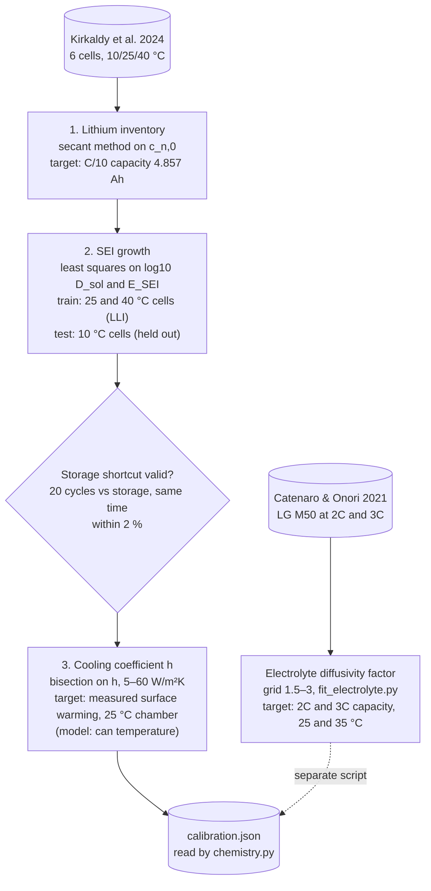

1. **Capacity.** Capacity is linear in the initial lithium concentration in the negative
   electrode, c_n,0, so three secant steps make the simulated C/10 capacity match the mean
   measured capacity of 40 cells, 4.857 Ah (Kirkaldy et al., Table 7).
2. **SEI growth.** The solvent-diffusion SEI model does not depend on current. A 70–85 %
   cycle therefore ages the model like storage at the same mean state of charge (0.775) and
   temperature, which is much faster to simulate. `check_storage_shortcut()` verifies this:
   20 real cycles and storage for the same time give LLI within 2 %. The parameters
   x = [log₁₀ D_sol, E_SEI] are fitted by bounded least squares to the measured LLI of the
   25 °C and 40 °C cells. Each cell is simulated at its measured surface temperature:

```math
\min_{x}\ \sum_{\text{cells}\in\{25,40\,^\circ\text{C}\}}\ \sum_{i} \left[\text{LLI}_{\text{model}}(x; T_{\text{cell}}, t_i) - \text{LLI}_{\text{meas}}(t_i)\right]^2
```

3. **Cooling.** The model's can temperature rise in the 25 °C chamber (mean over the second
   half of eight 70–85 % cycles) is matched to the rise measured on the cells' surface by
   bisection on h. The electrolyte factor is not part of this calibration; it is fitted
   separately to high-rate discharges (`scripts/fit_electrolyte.py`, Section 4.3).

### 5.3 Result

| Quantity | Default (Chen 2020) | Calibrated |
|---|---|---|
| Initial concentration in negative electrode | 29,866 mol/m³ | 28,342 mol/m³ |
| SEI solvent diffusivity | 2.5·10⁻²² m²/s | 2.19·10⁻²⁰ m²/s |
| SEI growth activation energy | 38 kJ/mol (O'Kane) | 25.4 kJ/mol |
| Heat transfer coefficient, can to chamber | n/a | 11.5 W/m²K (12 in the program; 13.0 with one temperature) |
| Electrolyte diffusivity factor (Catenaro 2021, Section 4.3) | 1 | 2 |
| LLI RMSE, training cells (25/40 °C) | n/a | 0.40 %-points |
| LLI RMSE, held-out cells (10 °C) | n/a | 2.56 %-points |
| Storage shortcut valid | n/a | Yes |

The fit reproduces lithium loss within 0.5 %-points at 28–41 °C cell temperature. At 16 °C
the model's lithium loss is 2.6 %-points lower than measured (those cells were not used in the
fit). A likely reason is that a mechanism that grows when cold, such as lithium plating, is
missing from the solvent-diffusion SEI model. `python scripts/validate.py` repeats the
comparison for both the physics and the empirical model (Section 10). The dashboard shows the
same figure under "How accurate is this?":

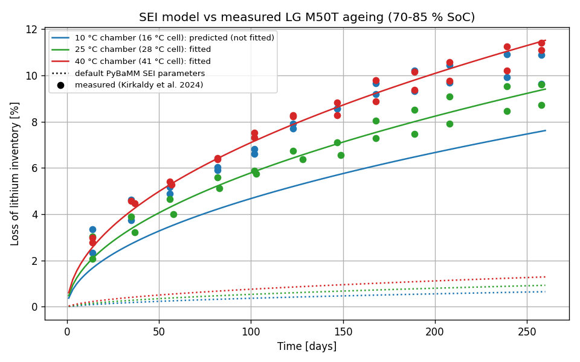

---

## 6. Empirical ageing models

### 6.1 Concept

Formulas fitted to real lab tests take those 10 cycles and project how much capacity is left after thousands more (up to 20,000 cycles). The simulated state-of-charge swing and cell temperature drive an empirical capacity-fade model for that chemistry. Each cycle is followed by a rest so that it lasts as long as in real use (set by "Cycles per year", 365 = once a day), because batteries also age while they sit idle (calendar ageing).

All lithium models are of the semi-empirical, additive form used by BLAST-Lite (Gasper et
al.):

```math
q(n) = 1 - \underbrace{L_{\text{cal}}(t_n;\ T,\ \text{SOC})}_{\text{calendar}} - \underbrace{L_{\text{cyc}}(\text{EFC}_n;\ \text{DoD},\ C,\ T)}_{\text{cycling}},
\qquad q \in [0, 1]
```

Here q(n) is the capacity fraction after n cycles, t_n the elapsed time and EFC_n the
equivalent full cycles.

| Chemistry | Physics parameters | Ageing model and data |
|---|---|---|
| NMC | Chen 2020 (LG M50), calibrated to Kirkaldy et al. 2024 | Calendar: NREL BLAST-Lite, LG M50 (Truong Bui et al., IEEE 2021). Cycling, incl. fast/cold charging: fitted to LG HG2 data (Luh & Blank, Sci. Data 2024; Preger et al. 2020; Wittman et al. 2023) and Ohneseit et al. 2025 |
| LFP | BYD Blade (Gorsch 2025, electrochemistry from Prada 2013) | NREL BLAST-Lite, Sony-Murata 3 Ah (Naumann et al. 2018, 2020; Gasper et al., JES 2022); cycling term rescaled to Ohneseit et al. 2025; fast-charge factor from Severson et al., Nat. Energy 2019 |
| NCA | Schmitt 2023 (Samsung INR21700-50E) | Calendar from NREL BLAST-Lite, Panasonic NCR18650B (Keil et al., JES 2016); cycling refitted to Preger et al., JES 2020 (Panasonic NCR18650B) and scaled to two Samsung 50E cells cycled for 530 full cycles (REBELION, 2024) |
| Na-ion | Schneider 2025 (Mushang NA18650-1250, layered oxide / hard carbon) | 0.05 % per cycle (adjustable), commercial layered-oxide 18650 cells cycled to 80 % (Liu et al., Applied Energy 412, 2026); best cells < 0.01 % (Liu 2026; Carter et al., Energies 18, 661, 2025) |

### 6.2 From the physics model to the stress factors

The last fully simulated cycle (time t, SOC, cell temperature T) is the *representative
cycle* that is assumed to repeat. `ageing.py` extracts the following from it:

| Stress factor | Definition |
|---|---|
| Equivalent full cycles per cycle | EFC₁ = ½ Σ\|ΔSOC\| |
| Depth of discharge | DoD = max SOC − min SOC |
| Mean discharge C-rate | c_dis = Σ(−ΔSOC) / Σ Δt over discharging intervals [1/h] |
| Charge-weighted charge C-rate | c_ch = Σ(r_i ΔSOC_i) / Σ ΔSOC_i, with r_i = ΔSOC_i/Δt_i over charging intervals. Weighting by charge makes the CV tail count little |
| Temperature while charging | T_ch = time-weighted mean cell temperature over charging intervals |
| Cycle period | Δt₁ = 365 · 86,400 s / (cycles per year), including the rest |

**Rest between cycles (`add_rest`).** Laboratory ageing tests cycle back to back, but a
battery in real use cycles, for example, once a day and spends the rest of the day idle,
where it keeps ageing (calendar ageing). After the simulated cycle, the program adds a rest
at the final state of charge and at the ambient temperature, so that each cycle lasts its
real period. If the cycle itself is longer than the requested period, no rest is added and
the achievable number of cycles per year is used instead. The test
`test_resting_between_cycles_adds_calendar_ageing` confirms that daily cycling ages the
cell more than the same cycles run back to back.

### 6.3 Closed-form evaluation

The BLAST-Lite models compute degradation rates from one simulated cycle; because the cycle
repeats, their capacity-loss trajectories are evaluated in closed form (matches BLAST-Lite's
own cycle-by-cycle stepping within 0.0004).

BLAST-Lite integrates power-law states such as dL = k · p · L^((p−1)/p) · Δx incrementally.
With constant rates k (the same cycle repeating), that integrates exactly to L = k · x^p, with
x = t or EFC. So the whole trajectory of 20,000 cycles is one vectorised expression,
independent of the step size. `test_calendar_term_matches_blast_stepping` checks this against
BLAST-Lite's own stepping.

### 6.4 NMC: calendar term plus refitted cycling term with lithium plating

**Calendar** (BLAST-Lite, LG M50, Truong Bui et al. 2021):

```math
L_{\text{cal}} = k_{\text{cal}}(T, U_a, \text{SOC})\left(\frac{t_{\text{days}}}{10^4}\right)^{p_{\text{cal}}},
\qquad p_{\text{cal}} = 0.652
```

k_cal is the time average over the cycle of a fitted function of normalised temperature,
anode potential U_a(SOC) and SOC.

**Cycling** (`NmcRefit`, refitted):

```math
L_{\text{cyc}} = \text{DoD}^{\,B}\left[K_{\text{base}} + K_{\text{pl}}\, c_{\text{ch}}^{\,N}\, \exp\!\left(-\frac{T_{\text{ch}} - 25}{T_{\text{pl}}}\right)\right]\text{EFC}^{\,P}
```

The second term grows with the charge rate and with colder cell temperature while charging.
Luh & Blank (2024) attribute this fast loss to **lithium plating**. BLAST-Lite's own LG M50
cycling term is not used: it aged faster when warmer and gave about 10x the life at 3C
discharge as at 1C.

| Parameter | Value | Meaning |
|---|---|---|
| K_base | 6.905·10⁻³ | Base cycling loss coefficient |
| K_pl | 8.545·10⁻³ | Plating loss coefficient |
| N | 0.602 | Charge-rate exponent |
| T_pl | 24.56 °C | e-folding temperature of plating |
| P | 0.442 | EFC exponent (fixed at BLAST-Lite's LG M50 value) |
| B | 0.630 | Depth-of-discharge exponent |
| Fit | 24 points, typical error ×1.38 in cycles to 80 % | |
| Validity | 0–40 °C, DoD 0.1–1, charge ≤ 1.67C, discharge ≤ 3C | |

P is fixed because the data are cycles to 80 % only, which do not pin down the curve shape.
The curves of Luh & Blank (fast loss in the first ~100 cycles, then slower) and Preger's NMC
curves give a similar exponent (0.4–0.5). Discharge rate has no clear effect in the data
(Preger: 0.5–3C; Luh & Blank: 1/3 and 1C; Ohneseit: 1 and 2C), so it is not in the model.

**Check on other NMC cells: depth, temperature and charge rate.** `scripts/validate_nmc_mj1.py`
runs the model, unchanged, against 42 LG INR18650 MJ1 cells (NMC / graphite-SiOx, 3.4 Ah)
of the TUM multi-stage study (Stroebl et al. 2024, `data/tum_mj1_2024`): 10, 20 and 30 °C,
depth of discharge 10–100 % around 50 % SOC, charge 0.33–1C, up to about 140 days. Each
test is rebuilt as a repeating cycle at the pace the cell actually cycled, so the calendar
loss counts.

- The 15 cells charged at the MJ1's standard 0.5C or slower: 4.9 %-points RMS over all
  check-ups. The 10 % depth cells (the car's daily use is about 13 %) end within 0.7
  %-points on average; this is why the validity now starts at 10 % depth.
- The 18 cells charged at 0.66C or faster over 50 % or more of their capacity lost a median
  49 % within 60–850 EFC; the model gives 84 %. These are energy cells with silicon charged
  above their standard rate. The model's charge-rate term comes from the LG HG2, a power
  cell, so the dashboard warns when an NMC cell is charged at 0.66C or faster over half or
  more of its capacity (`ageing.MJ1_FAST_FADE_C`). The program's NMC cell, the LG M50, is
  also a silicon energy cell (standard charge 0.3C, maximum 0.7C).

**Charge rate.** NMC ages faster with faster charging at any rate, LFP only above about
2.3C (Section 6.6). NMC also ages faster when
the cell is cold while charging (lithium plating), so cooling matters: a strongly cooled
cell stays colder during fast charging. Discharge rate has no effect for NMC (none was seen
in the data).

Pre-conditioning removes this cold-charge penalty: in `test_preconditioning_keeps_cold_nmc_alive_longer`
(5 °C ambient, 1.5C charge), the liquid cold plate keeps the cell above 20 °C and gives a
longer life than forced air.

### 6.5 NCA: calendar term plus refitted cycling term, at the Samsung 50E's level

**Calendar** (BLAST-Lite, Panasonic NCR18650B, Keil et al. 2016):

```math
L_{\text{cal}} = k_{\text{cal}}\, t_{\text{days}}^{\,0.512},
\qquad
k_{\text{cal}} = A_{\text{cal}}\, e^{B_{\text{cal}}/T}\, e^{C_{\text{cal}}\,\text{SOC}/T}
```

**Cycling** (`NcaRefit`, refitted to Preger et al. 2020, same cell as the calendar term, then
scaled to the Samsung 50E):

```math
L_{\text{cyc}} = \lambda_{50E}\ F_{\text{ch}}\ A\ \text{DoD}^{\,B}\ \text{EFC}^{\,P},
\qquad
F_{\text{ch}} = 1 + K_{\text{ch}}\,\max(c_{\text{ch}} - 0.5,\,0)\,\exp\!\left(-\frac{T_{\text{ch}} - 25}{T_{\text{ch},0}}\right)
```

(Preger's Panasonic rows are fitted with a discharge factor clip(c_dis, 0.5, 2)^−C and
λ = 1, F_ch = 1; the 50E uses neither the factor nor Preger's level, see below.)

| Parameter | Value |
|---|---|
| A | 1.469·10⁻³ |
| B (DoD exponent) | 0.806 |
| C (discharge-rate exponent, Panasonic only) | 0.297 |
| P (EFC exponent) | 0.787 |
| Fit (Panasonic, A–P) | 18 points, RMS error 2.0 %-points of capacity |
| λ₅₀E (level of the Samsung 50E) | 0.381 |
| Fit (50E level) | Two 50E cells, 578 cycles each (REBELION): RMS error 0.63 %-points (8.5 at the Panasonic level) |
| K_ch, T_ch,0 (charge rate of the 50E) | 2.733, 18.95 °C |
| Fit (50E charge rate) | Huang et al. 2026, 23 and 40 °C, 6 conditions, 57 points: RMS error 2.2 %-points |
| Validity | 15–35 °C, DoD 0.2–1, charge ≤ 1C, discharge ≤ 2C |

Preger found no clear temperature effect on NCA cycling between 15 and 35 °C at a 0.5C
charge, so the cycling term has none at that rate; temperature still acts through the
calendar term. Faster discharge gave slower fade on Preger's Panasonic cell at all three
temperatures (the cause is unclear), but not on the 50E (below) nor on Zhu et al.'s (2022)
NCM/NCA 18650 cells (0.5C charge, 1, 2 and 4C discharge at 25 °C: 470–510 cycles to 80 %
for all nine cells, `Dataset_3`, Zenodo 6405084), so the program uses no discharge factor.

**Charge rate of the 50E.** Huang et al. (2026, Electronics 15, 2563) cycled 27 50E cells
0–100 % at 0, 23 and 40 °C with 0.5C or 1C charge and 1C or 2C discharge (three cells each).
Their Figure 5b, read by eye into `data/huang2026`, gives the fade per condition. At 23 °C a
1C charge reached 80 % after about 430 cycles, where the 0.5C charge had lost only 10 % at
500; at 40 °C both charge rates lasted about 750–800 cycles. F_ch, the extra wear of charging
faster than the cell's standard 0.5C, fades with temperature like the NMC plating term;
it is fitted to the 23 and 40 °C conditions (NCA step 3): 2.2 %-points RMS. The 40 °C,
0.5C cells faded faster than the model (18 vs 14.5 % at 750 cycles), and with the 2C
discharge at 23 °C the cells reached 80 % after about 260 cycles, where the model, without a
discharge factor, gives the same as for 1C (about 470). At 0 °C
every condition lost 15–28 % within 30–50 cycles (lithium plating), far beyond the model:
0 °C is outside its 15–35 °C, and the dashboard warns.

**Level of the program's cell.** The physics model's NCA cell is the Samsung INR21700-50E,
whose ageing differs from the Panasonic 18650's. The REBELION project (UNED, Horizon Europe;
e-cienciaDatos, doi 10.21950/GT4LKX, CC BY 4.0) cycled 50E cells 0–100 % with four
strategies; `scripts/extract_rebelion.py` takes the capacity of every discharge
(`data/rebelion2024`). The two cells charged CC-CV at 0.5C and discharged CC at 1C (the
program's own cycle) lost 12.5 % in about 530 full cycles over 200 days. λ₅₀E scales the
Panasonic cycling term to them (`scripts/fit_ageing.py`, NCA step 2; the cycle is stretched to
the test's pace so the calendar loss counts; 25 °C assumed, as the room temperature is not
recorded): 0.63 %-points RMS. Checks not used in the fit:

- The two cells that also held the voltage at 2.5 V at the end of each discharge (CC-CV
  discharge) faded faster, 17 % in 455 cycles: 1.8 %-points RMS, and from about 430 cycles
  a knee the model does not have.
- The four cells charged without the CV hold (CC only, and CC with a CV discharge) delivered
  less (4.2–4.3 Ah) and collapsed after 390–420 cycles, to under 0.3 Ah within a few cycles.
  The model has no such sudden failure.
- With λ₅₀E the model gives 1,420 full cycles to 80 % at 0–100 %, 1C, 25 °C (1,470 at 20 °C),
  where Ohneseit et al. (2025) measured about 1,300–1,500 on 21700 NCA cells at 20 °C, 1C.

### 6.6 LFP: rescaled BLAST-Lite model with a fast-charge factor and a knee

**Model** (BLAST-Lite, Sony-Murata 3 Ah 18650; Naumann et al. 2018, 2020; Gasper et al. 2022).
The calendar loss is a sigmoid in time, and the cycling loss is a power law in throughput:

```math
L_{\text{cal}} = 2 q_1\left(\tfrac12 - \frac{1}{1 + \exp\!\left[(q_2\, t_{\text{days}})^{q_3}\right]}\right),
\qquad
L_{\text{cyc}} = S \cdot \max\!\left(1, \frac{c_{\text{ch}}}{C_{\text{th}}}\right)^{M}\,(q_5\,\text{EFC})^{q_6}
```

q₁ and q₃ depend on temperature and anode potential, q₂ = 1.305·10⁻⁴ and q₆ = 1.128. q₅
depends on DoD and C-rate. A break-in term is added only above 3 equivalent full cycles
per day. The knee then bends the cycling loss around 20 % (Section 10.1), in proportion to
the fast-charge share F = max(1, c_ch/C_th)^M of the wear:

```math
L_{\text{cyc}} \leftarrow 0.2\left(\frac{L_{\text{cyc}}}{0.2}\right)^{1 + (\kappa - 1)(1 - 1/F)}
```

| Parameter | Value | Fitted to |
|---|---|---|
| S (scale) | 7.644 | Ohneseit et al. 2025, 21700 LFP, 0–100 %, 20 °C, 1C (≈1,600 cycles to 80 %) |
| C_th (charge-rate threshold) | 2.285C | Severson et al. 2019 (A123, 3.6–8C, 30 °C) and Preger et al. 2020 (A123, 0.5C) |
| M (fast-charge exponent) | 2.901 | Same as C_th |
| κ (knee) | 3.314 | Severson's capacity curves, cycle by cycle (81 cells of the fitted batches) |
| Fit (fast charge) | Typical error ×1.27 over 82 cells (81 Severson + 1 Preger) | |

The Sony-Murata cell is an unusually durable high-power cell. Its BLAST-Lite model gave
about 8,000 cycles to 80 % for full cycles at 20 °C and 1C, against about 1,450–1,900 measured
by Ohneseit et al. for a commercial 21700 LFP cell. Ohneseit's test used the same lab,
protocol and cell format as the NMC data, so the scale factor S puts LFP and NMC on a common
basis.

### 6.7 Sodium-ion

```math
q(n) = 1 - f\, g(\mathrm{DoD})\, \text{EFC}_n,
\qquad f = 0.0005 \text{ per EFC (default; adjustable)},
\qquad g = 0.049^{\,\mathrm{clip}\left(\frac{1-\mathrm{DoD}}{0.4},\,0,\,1\right)}
```

The default fade rate f is measured on two commercial layered-oxide (NFM) 18650 cells from
two production batches, cycled 0–100 % at 0.2C and 25 °C until 80 % (about 400–450 cycles;
Liu et al. 2026, Fig. 23). The best commercial sodium-ion cells lose under 0.01 % per cycle
(Liu's Cu-Fe-Mn oxide cell, about 0.008 %; Carter et al. 2025). The cell of the physics model,
cycled between 20 and 80 % at 1C (Rehm et al. 2026, `data/rehm2026`), lost 3.1–10.6 % in
4,000–5,100 EFC (three of four cells; the fourth 32 % in 3,450 EFC): a median 0.0024 % per
EFC, 1/20 of the full-cycle rate. Cells from the same maker cycled fully at 0.5C at Sandia
lost 20 % in about 350 cycles, like Liu's, so the shallower window, not the maker, makes most
of the difference. The factor g is therefore 1 for full cycles, 0.049 at 60 % depth and
below (held: no data for shallower cycles), and geometric in between; the car (about 13 %
a day) and the second life (80 % by default) use it. The model counts throughput only, so
neither rest nor temperature changes it.

### 6.8 Parameter identification

The NCA and NMC cycling terms, the NCA level of the Samsung 50E, and the LFP cycling factors
and knee are fitted by `python scripts/fit_ageing.py` (written to `results/ageing_fit.json`; the program reads
`src/battery_twin/data/ageing_fit.json`, so a new fit is used by copying that one file, as for
the calibration) to published values in `src/battery_twin/data/published_ageing.csv`
(read from the figures and text of Preger et al. 2020, Wittman et al. 2023, Ohneseit et al.
2025 and Luh & Blank 2024) and `severson2019_cycle_life.csv` (Severson et al. 2019,
Supplementary Table 9; all 124 cells), plus the cycle-by-cycle data of Severson's cells (the
knee) and of REBELION's 50E cells (the NCA level). For the 46 published points the raw data
files were not available, so the values were read from the papers. BLAST-Lite's own NCA
cycling term gave about 5,000 cycles to 80 % where Preger measured about 430 on the same
cell; its NMC term had no depth-of-discharge or charge-rate effect, aged faster when warmer
(the data show the opposite for cycling) and gave about 10x the life at 3C discharge as at 1C.

`published_ageing.csv` contains 46 points:

| Chemistry | Source | Points |
|---|---|---|
| NCA | Preger et al. 2020, Fig. 2a, 3c, 3f, 3i (Panasonic NCR18650B) | 18 |
| NMC | Luh & Blank 2024, Fig. 12 (LG HG2; median of three cells, read from the figure's pixels) | 16 |
| NMC | Preger et al. 2020, Fig. 2a (LG HG2) | 3 |
| NMC | Wittman et al. 2023, text (LG HG2) | 3 |
| NMC | Ohneseit et al. 2025, Fig. 5/6 (NMC811 + Si 21700) | 2 |
| LFP | Ohneseit et al. 2025, Fig. 5/6 (21700 LFP) | 2 |
| LFP | Preger et al. 2020, Fig. 3g (A123 APR18650M1A) | 1 |

Each published test is rebuilt as a repeating laboratory cycle (CC discharge, rest, CC
charge with a 30-minute CV hold at 100 %, rest) and run through the *same*
`predict_capacity` function as the dashboard. The fitted model therefore includes the
calendar ageing that happened during each test.

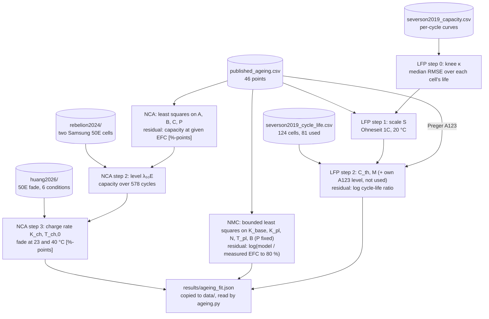

For NCA, the residual is the difference in capacity at the measured number of EFC. For NMC
and LFP, it is the logarithmic error in cycles to 80 %:

```math
r_i = \ln\frac{\text{EFC}_{80,\text{model}}}{\text{EFC}_{80,\text{measured}}},
\qquad \text{typical error} = \exp\!\left(\sqrt{\overline{r_i^2}}\right)
```

To keep the objective smooth, the model's cycles to 80 % are interpolated linearly between
cycles. Severson's 2017-06-30 batch is left out because the same charging policies gave much
shorter lives than in the other two batches (e.g. 4.8C: about 470 vs about 750 cycles). In
LFP step 2, the A123 cells get their own level factor, because they last longer than
Ohneseit's cell. Only C_th and M go into the program. Step 0 (the knee) uses the levels of
the previous fit, so the script is run until κ, C_th and M stop changing (three runs).

### 6.9 Sensitivity range and validity warnings

**Shaded range.** For lithium chemistries, the prediction is repeated with the cell
temperature shifted by −5 °C and +5 °C. For sodium-ion, it is repeated with the best and worst
measured commercial cells (0.01–0.05 %/cycle). The envelope of the three curves is shaded.

**Cut-off.** Capacity below 50 % is set to "no data".

**Warnings.** `validity_warnings` compares the mean cell temperature, charge and discharge
rates, depth of discharge and (for sodium-ion) cycle count with each model's
`experimental_range`. The dashboard lists every condition outside it.

---

## 7. Techno-economic analysis (money)

### 7.1 Application and method

The ageing curve tells the economics how much energy the battery delivers each year. The capacity curve feeds an arbitrage TEA (NPV, IRR, payback, LCOS, second life) cycle by cycle: when capacity drops below the retirement threshold the battery stops earning and stops costing. The threshold is the one with the highest NPV (Section 7.4); it is the program's one end of life, used by the TEA, the LCA and both reports.

The modelled application is **energy arbitrage on the Portuguese day-ahead market**: the
battery buys electricity in the cheapest hours of a day and sells it in the dearest hours.
Earlier versions used a fixed price and spread; these were assumptions and have been
replaced by measured hourly prices (Section 7.2). Every other input now comes from a
published source or from the simulation (Section 7.3).

**Standards.** No ISO standard prescribes formulas for a techno-economic analysis, but
several standards set its structure:

| Standard | What it covers | How it is applied here |
|---|---|---|
| ISO/TS 14076:2025, *Environmental techno-economic assessment (eTEA): principles, requirements and guidance* | Framework for a TEA combined with an LCA. Clause 6 sets the phases: goal and scope, technical analysis, economic analysis, life cycle assessment, sensitivity analysis, combined interpretation. Clause 4 sets the principles: basis of production, functional unit and reference flows, transparency. Clause 7 sets the documentation requirements, including digital files | TEA and LCA use the same functional unit (1 kWh delivered), the same ageing curve and the same end of service life (the retirement threshold of highest NPV). Technical analysis: physics and ageing models. Sensitivity: tornado chart. Combined interpretation: LCOS and carbon footprint side by side (Compare tab). Documentation: downloadable cash-flow table (CSV) and every input with its source (JSON) |
| IEC 60300-3-3:2017, *Life cycle costing* | Life-cycle cost concepts: a cost breakdown over the life cycle (acquisition, operation and maintenance, disposal) | Cost breakdown per year: acquisition (CAPEX), operation (charging energy, grid fees), maintenance (O&M, warranty), income tax. Disposal: none, the producer takes the battery back free of charge (Regulation (EU) 2023/1542, art. 61(1)) |
| ISO 15686-5:2017, *Life-cycle costing* (constructed assets) | Net present value, discount rate, real vs nominal costs, sensitivity | Nominal cash flows (prices, fees and O&M escalate) discounted at a nominal rate (Steffen's WACC is nominal) |
| IEC 62933-2-1, *EES systems: unit parameters and testing methods* | Round-trip efficiency of an energy storage system measured at its grid connection | The efficiency includes inverter and auxiliary losses, not only the cell (Section 7.3) |

Only the public scope and contents of these standards were available, not their full
text. The structure above follows their published clause titles. The full documents would
be needed to claim conformity.

**Daily dispatch.** For every day d of the price file, the program finds the best single
cycle with perfect foresight of that day's prices. A new battery needs
h_dis = DoD / c_dis hours to discharge and h_ch = DoD / (η_RT · c_ch) hours to charge at its
rated C-rates. For every split hour s, it charges in the cheapest h_ch hours before s and
discharges in the dearest h_dis hours after s (the last hour may be partial), and keeps
the split with the largest margin:

```math
\bar{p}^{\,\text{buy}}_d,\ \bar{p}^{\,\text{sell}}_d = \arg\max_{s}\left[\bar{p}^{\,\text{sell}}_{d}(s) - \frac{\bar{p}^{\,\text{buy}}_{d}(s)}{\eta_{\text{RT}}}\right],
\qquad
m_d = \bar{p}^{\,\text{sell}}_d - \frac{\bar{p}^{\,\text{buy}}_d}{\eta_{\text{RT}}}
```

Here m_d is the margin per kWh delivered. Prices may be negative (the battery is then paid
to charge). The battery cycles N_y times a year (sidebar); it uses the N_y days with the
highest margin, so with 365 cycles a year it cycles every day, including days on which it
loses money, as the ageing model assumes. The mean buying price p and the mean spread
s = p̄_sell − p are passed to the cash-flow model below. The price model allows one cycle
per day; above 365 cycles a year the extra cycles get the same mean prices (optimistic, and
the dashboard warns).

**Cash flows.** In year y the battery runs cycles
k ∈ K_y = {N_y(y−1)+1, …, N_y·y} (plus an offset for second life), and only the cycles with
q_k ≥ q_ret count. After the first cycle below q_ret, the battery is retired: it has no
revenue and no operating cost from then on.

```math
E^{\text{out}}_y = C_{\text{pack}}\cdot \text{DoD}\cdot \sum_{k\in K_y,\ q_k\ge q_{\text{ret}}} q_k,
\qquad
E^{\text{in}}_y = \frac{E^{\text{out}}_y}{\eta_{\text{RT}}}
```

```math
CF_0 = -\text{CAPEX} = -c_{\text{cap}}\, C_{\text{pack}},
\qquad
CF_y = \underbrace{\left[E^{\text{out}}_y\,(p + s) - E^{\text{in}}_y\,p\right](1+i)^y - \text{OPEX}_y - G_y}_{\text{EBITDA}_y} - T_y
```

Prices are those of 2025 and rise with inflation i_y: Banco de Portugal's HICP projections
(3.1 % in 2026, 2.4 % in 2027, 2.0 % in 2028; Boletim Económico, June 2026), then the ECB's 2 %
target. The factor (1+i)^y in the equation stands for the product of the yearly rates from 2025
to the calendar year (`economics.price_index_from_base`), so a second life that starts later
also sees that year's prices.
G_y are the grid fees: zero until 2029, then optional (Section 7.3). T_y is the corporate
income tax:

```math
T_y = \tau_y \cdot \max\!\left(0,\ P_y - \min(L_{y-1},\ 0.65\,P_y)\right),
\qquad P_y = \text{EBITDA}_y - D_y,
\qquad \tau_{2026} = 19\,\%,\ \tau_{2027} = 18\,\%,\ \tau_{\ge 2028} = 17\,\%
```

D_y is the tax depreciation: straight-line at d = 20 % of CAPEX a year until the book value
is zero. Batteries are not listed in the Portuguese depreciation tables; PwC's summary
gives 20 % for electronic equipment, the closest category for a battery system with its
power electronics (12.5 % for engines and machine tools). The minimum allowed is half the
maximum (Decreto Regulamentar 25/2009, explained by the Ordem dos Contabilistas
Certificados), so the dashboard allows 10–20 %. When the battery is retired, its remaining
book value is written off (assumption). L are the tax losses carried forward: without time
limit, but each year they can offset at most 65 % of the taxable income (PwC). The previous
version used straight-line depreciation over the project lifetime and an unlimited loss
offset, both assumptions.

```math
\text{OPEX}_y = c_{\text{O\&M}}\,C_{\text{pack}}\,(1.025)^{\,y-1} + 0.009\cdot\text{CAPEX}\cdot[\,y \ge 3\,]
\qquad \text{(only while working)}
```

The earlier OPEX assumption, 1.5 % of CAPEX per year, has been replaced by Lazard's
general O&M plus warranty (Section 7.3). The LCOS below is before tax and includes grid
fees in its costs.

```math
\text{NPV} = \sum_{y=0}^{Y}\frac{CF_y}{(1+r)^y},
\qquad
\text{LCOS} = \frac{\text{CAPEX} + \sum_{y=1}^{Y}\frac{E^{\text{in}}_y p + \text{OPEX}_y}{(1+r)^y}}{\sum_{y=1}^{Y}\frac{E^{\text{out}}_y}{(1+r)^y}}
```

The IRR is the r for which NPV = 0 (numpy-financial). The discounted payback is the first
year in which the cumulative discounted cash flow is non-negative ("Never" if it does not
happen within the project).

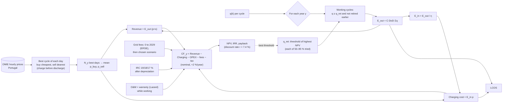

### 7.2 Electricity prices

`scripts/download_omie_prices.py` downloads one calendar year of hourly marginal prices of
the Portuguese zone of the Iberian day-ahead market (OMIE) with the OMIEData package and
writes `src/battery_twin/data/omie_prices_pt_<year>.csv` (date, hour, €/MWh). The dashboard
uses the most recent file. Without a file, it falls back to the old fixed price and spread
and shows a warning. Since 1 October 2025 the day-ahead market clears in 15-minute periods.
OMIEData's reader keeps only the first 25 values of those files (00:00–06:15), so the script
reads the files itself and averages the quarter-hours to hours. The file in the repository
was made with the original reader, so it keeps only 1 January to 30 September 2025 (273
days); running the script again gives the full year.

### 7.3 Inputs and their sources

All dollar values are converted at the ECB 2025 average of 1.1300 USD per EUR.

| Input | Value | Source |
|---|---|---|
| CAPEX (whole system) | LFP and Na-ion €284/kWh; NMC €298/kWh; NCA €303/kWh | NREL (Cole et al. 2025): $321/kWh for a 4-hour system in 2025 (mid); NREL's system is LFP based; a system bought later (the second life) uses NREL's mid projection for that year (Table 2: $257/kWh in 2033, 2024 dollars). Plus the cell-price difference to LFP from Benchmark Mineral Intelligence's June 2025 assessment (weighted averages: LFP $50.2, NCM $66.0, NCA $71.7/kWh). Sodium-ion: Keiner et al. (2026) estimate sodium-ion cells at about 93 €/kWh in 2023, the same as LFP. The previous version used BNEF's pack prices (LFP $81, NMC $128), which mix regions and segments, and had no NCA or sodium-ion price |
| Electricity buying price p and spread s | From the hourly prices | OMIE, Portugal (Section 7.2) |
| Round-trip efficiency η_RT | Simulated cell efficiency × 83/91 (= 0.912) | PNNL-27237 (Viswanathan et al. 2018), Table 2.2: on a 1 MW lithium-ion battery at 1C, 91 % without and 83 % with auxiliary loads and rest periods. The previous factor (0.91) was chosen to match NREL's 85 %; the measured ratio gives the same value. Check: LFP at the default settings gives 83 % (NREL assumes 85 %; PNNL 2020 measured 83–87 %). Schimpe et al. (2018) found 70–80 % for a small low-voltage system, where power electronics and auxiliaries weigh more |
| Depth of discharge | Storage depth, default 80 % (sidebar) | The storage cycle is the simulated test cycle squeezed to this depth around 50 % SOC; the ageing and the energy per cycle use the same cycle |
| Operation and maintenance | $1.53/kWh per year (€1.35), +2.5 %/year; warranty 0.9 % of CAPEX per year from year 3 | Lazard LCOS 7.0 (2021). Lazard's augmentation cost (3 % of equipment) is left out, because the program models the fade and retirement itself |
| Project lifetime Y | 15 years | NREL (Cole et al. 2025) |
| Discount rate r | 7.4 % | Steffen (2020), Table 2: after-tax WACC for Portugal (onshore wind, the closest technology with data), at 2017 interest rates. High case: Lazard's financing (80 % equity at 12 %, 20 % debt at 8 %, 21 % tax) = 10.9 % |
| Cycles per year N_y | From the sidebar (default 365) | Setting |
| Retirement threshold q_ret | The threshold of highest NPV among 50–95 % (`tea_at_best_retirement`) | Calculated, not a setting. It is also the LCA's end of service life q_EoL, so TEA and LCA describe the same service life (ISO/TS 14076). At the default settings it is 50 %, where the ageing data end: below the CFB-IND minimum of 70 %, which the LCA report and the Environment tab flag (the LCA report also gives the value at 70 %) |
| Grid fees | 0 until the end of 2029; afterwards a choice | ERSE Regulamento Tarifário (Regulamento n.º 1218/2025), art. 56: storage that does not take part in self-consumption is exempt from network access tariffs on energy that is later fed back, until the end of 2029. ERSE Orientação n.º 1/2026: system regulation charges are exempt on charging, and on injection below 10 MVA. From 2030 the choice is: exemption continues (default), MT access tariff or BTE access tariff (2026 values, ERSE Diretiva 10/2025, art. 15): energy in "horas cheias" (MT €0.0182/kWh, BTE €0.0353/kWh), the midday hours in which the battery charges, plus contracted power (MT €0.0458, BTE €0.0563 per kW per day) at the charging power |
| Corporate income tax (IRC) | 19 % (2026), 18 % (2027), 17 % (2028 onwards) | EY Tax Alert on the 2026 State Budget (Proposta de Lei n.º 16/XVII, approved by Parliament on 18 September 2025). Depreciation 20 %/year straight-line (PwC: electronic equipment; minimum 10 %, DR 25/2009); losses carried forward, offsetting up to 65 % of a year's taxable income (PwC); no municipal or state surcharges (assumption). The reduced 15 % rate for SMEs on the first €50,000 is not applied |
| Inflation and start year | 3.1 % (2026), 2.4 % (2027), 2.0 % (2028), then 2 % a year; operation from 2026 | Banco de Portugal, Boletim Económico June 2026 (HICP projections), then the ECB target; the start year is a setting. Needed because the discount rate is nominal |
| IRC surcharges, write-off, disposal | None; remaining book value deducted at retirement; no disposal cost | State surcharge only above €1.5M taxable profit (CIRC art. 87.º-A); municipal surcharge (1.5 % in most municipalities) waived in Lisbon and many others for a turnover up to €150,000 (AT Ofício Circulado 20288/2026); exceptional write-off, CIRC art. 38 (now 31.º-B), AT ruling PIV 693; producers take back waste industrial and EV batteries free of charge (Regulation (EU) 2023/1542, art. 61(1)) |
| Second-life battery | $28.03 per kWh it still holds, plus $24.38 per nameplate kWh for repurposing ($44 per nameplate kWh at 70 % left) | NREL B2U Repurposing Cost Calculator (June 2020) at its defaults: 5 kWh modules at 70 % capacity, 1 GWh a year, regional collection; repurposing = collection, testing, labour, facility and warranty. Dong et al. (2023) report $44–180/kWh |

The earlier default values were CAPEX NMC 125, LFP 95, NCA 130, Na-ion 90 €/kWh (battery
only, indicative), electricity price 0.20 €/kWh, spread 0.10 €/kWh, round-trip efficiency
0.90, depth of discharge 0.80, discount rate 7 % and OPEX 1.5 % of CAPEX. All were
assumptions.

**Not included:** disposal or recycling costs, ancillary-service revenues and intraday
trading. Earlier versions also left out grid fees, taxes and inflation; these are now
included (ERSE's 2026 tariff announcement, the first source checked, gives only the yearly
changes, so the tariff regulation and directive themselves are used).

### 7.4 Sensitivity and second life

- **Tornado chart (ISO/TS 14076, sensitivity analysis):** the NPV change when CAPEX, the
  electricity price level, the arbitrage spread, the discount rate, the round-trip
  efficiency or the O&M cost change by ±20 %, one at a time.
- **Documentation (ISO/TS 14076, clause 7):** the Economics tab shows the yearly cash flows
  and downloads them as CSV, and downloads every input with its source or status as JSON.
- **When to retire** (`best_retirement`, expander in the Economics tab): the NPV for
  retirement thresholds from 50 to 95 % capacity, and the best one. The idea comes from
  Thelen et al. (2023), who chose when to retire each cell from its predicted curve (there
  by several attributes; here by NPV only). A retired battery earns nothing and has no resale
  value, so it pays to keep it while one more year of arbitrage covers that year's O&M,
  warranty and grid fees. With the defaults (no grid fees) the best threshold is the lowest,
  50 %, where the ageing data end. With the 2030 access tariffs the fixed yearly fees make
  retiring earlier pay: for a 60 kWh LFP battery at the default cell settings and a fixed
  price spread, the best threshold is 80 %, €0.6k (MT tariff, €0.10/kWh spread) to €2.5k
  (BTE tariff, €0.05/kWh) better than 70 %. The program retires the battery at the best
  threshold, and the LCA uses the same threshold as its end of service life.
- **Second life:** an EV battery reused for stationary storage. Its first life is in a car
  (`ageing.ev_first_life`): every day a one-hour drive from the daily charge limit (100 % for
  LFP, which Tesla advises for its LFP cars; 80 % for NMC and NCA) using distance × 0.16
  kWh/km, a charge back at the sidebar's charge rate (default 0.3C, 18 kW on 60 kWh) and parked the rest
  of the day at the ambient temperature, for the chosen years (default 8 years at 50 km/day,
  Euro 7's 160,000 km). For NMC, the car's calendar and cycling losses are scaled to fleet data
  (× 0.56 and × 0.22; Section 9, "Car first life, compared with measurements"). The dashboard
  checks Euro 7's minimum durability (Regulation (EU)
  2024/1257: 80 % up to 5 years or 100,000 km, 72 % up to 8 years or 160,000 km). The battery
  then runs the storage cycle: the battery test cycle squeezed to the second-life depth of
  discharge around 50 % SOC (default 80 %, i.e. 10–90 %; its timing is the test cycle's, and
  its warming above the coolant is scaled by the depth, as a cycle at the same current makes
  heat in proportion to the charge it moves). The new LFP system it is compared with runs the
  same cycle, and the TEA counts the energy at that depth, with the arbitrage prices of the
  best hours for a cycle that deep (`ageing.second_life_curve`): its calendar and cycling losses
  each go on from where the car left them, at the storage cycle's rate for that loss (a loss
  the storage cycle never reaches is held). LFP leaves the car with mostly calendar loss,
  whose rate has slowed down by then, so it fades less than a new battery's storage curve
  from the same capacity. For NMC the car's cells keep their field factors in storage
  (`ageing.EV_FIELD_SCALE`; the same factors fit the ID.3 cell's highway lab test, so they
  belong to the cell); a new storage system keeps the laboratory model. The same
  `calculate_tea` runs on that curve. For LFP, the aged-cell windows also add the ohmic
  resistance growth measured on the 280 Ah LFP cell (+34 % at 7 % capacity lost, Gray &
  Vagg 2026), held at that value below 93 % (about +50 % in total at 80 %, the top of
  Ohneseit et al.'s +10–50 %). CAPEX is replaced by
  the second-life system cost: the repurposed battery (NREL B2U: bought by the capacity it
  still holds, plus the repurposing cost per nameplate kWh) and a new balance of system (NREL
  system cost minus the BNEF stationary pack price, $251/kWh). The dashboard compares it
  with what a buyer would otherwise install, a new LFP storage system (the market standard)
  on the same storage cycle over the same years, shows how that comparison moves when one
  input changes (used-battery price, arbitrage spread, second-life years, and for NMC the
  laboratory ageing in storage), and gives the carbon footprint per kWh delivered over the
  car life only, both lives with the production shared, the second life alone (cut-off: only
  the repurposing test electricity, 0.62 kWh per nameplate kWh from the NREL B2U calculator)
  and the new LFP system (`environment.second_life_carbon`). Both reports include it (TEA
  section 3.6, LCA section 4.6).
- **Comparison:** the "Compare chemistries" tab runs all four chemistries through the same
  function with the same inputs (except their own CAPEX and ageing model) on the battery test
  cycle at full depth, so its values for the run's chemistry differ from the Economics tab's,
  which uses the storage cycle.

### 7.5 Downloadable TEA report

The Economics tab's **"Download TEA report"** buttons generate a report of the current run
as PDF or Word (`tea_report.build_tea_report`). Every page carries the statement *"A
techno-economic assessment following the framework of ISO/TS 14076:2025, not critically
reviewed"*. It has an abstract and the phases of ISO/TS 14076, clause 6:

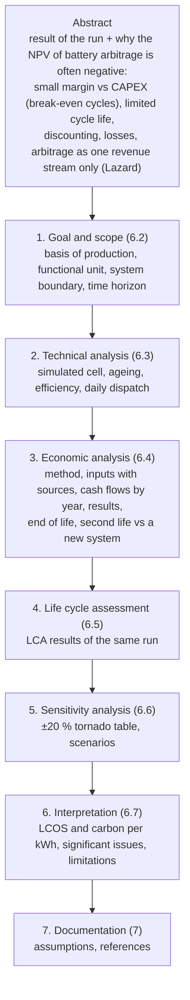

The abstract's context uses the run's own numbers. The break-even number of cycles is the
system cost divided by the margin per kWh delivered. It is compared with the cycles the
battery lasts before retirement. A sourced example of revenue stacking comes from Lazard
(2021): a California standalone battery with a 23.7 % project IRR earned $747 of its
$2,771/kW revenue from energy arbitrage. The rest came from capacity, frequency regulation
and reserves.

---

## 8. Screening life cycle assessment (environment)

A screening LCA gives CO2eq, water and ecotoxicity. The carbon footprint was originally
computed from the data sheet and pack size only. It now also uses the ageing curve, because
the functional unit is the energy delivered over the service life. The full report that the
dashboard downloads is described in Section 8.6.

### 8.1 Goal and scope (ISO 14044 §4.2)

- **Goal:** to estimate, at screening level, the climate change, water consumption and
  freshwater ecotoxicity of the simulated battery per unit of service, and to show how the
  operating conditions (through ageing) change them.
- **Statement:** *a screening LCA following ISO 14040/14044, not critically reviewed.* The
  results are not suitable for comparative assertions disclosed to the public (ISO 14044
  §5.2 and §6).
- **Functional unit:** 1 kWh of energy delivered by the battery over its service life
  (Regulation (EU) 2023/1542, Annex II; CFB-IND rules).
- **Reference flow:** the battery mass needed per functional unit,
  m_pack / E_total, where m_pack = C_pack / (specific energy).
- **System boundary:**

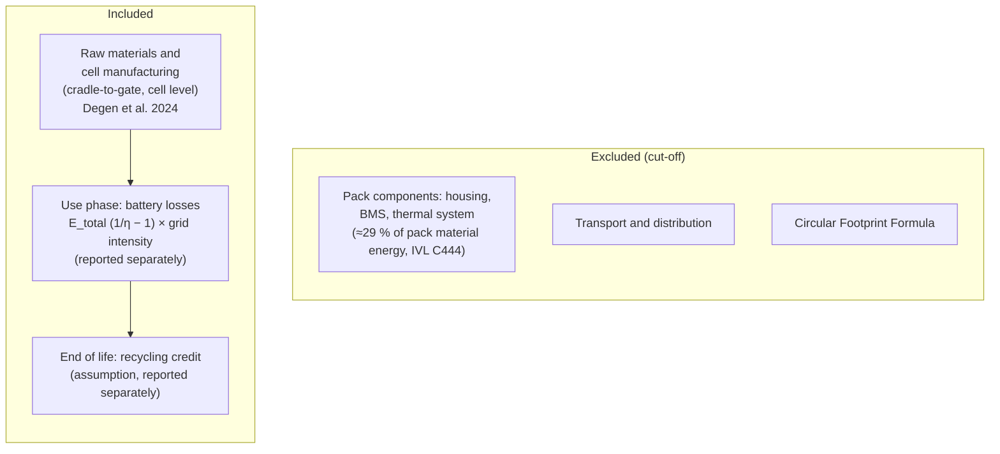

### 8.2 Life cycle inventory and the functional unit (ISO 14044 §4.3)

For stationary storage, the total energy delivered follows CFB-IND §3.2.1. Each cycle
delivers the pack capacity times its remaining capacity fraction, until the capacity first
falls below the end-of-service-life threshold q_EoL: the TEA's retirement threshold of
highest NPV, so both assessments share one end of life (CFB-IND requires q_EoL ≥ 70 % for a
conforming declaration; below that the report says so). The service life is also
limited to Y_s · min(N_y, 1000) cycles, with Y_s the service-life cap (15 years, the project
lifetime) and at most 1,000 cycles counted per year (CFB-IND):

```math
E_{\text{total}} = C_{\text{pack}} \sum_{k=1}^{n^*} q_k,
\qquad
n^* = \min\!\left(\min\{k : q_k < q_{\text{EoL}}\},\ Y_s\cdot\min(N_y, 1000)\right)
```

For the electric-vehicle case, the CFB-EV rule is used: E_total = lifetime distance ×
consumption, with the lifetime distance = distance per day × 365 × years in the car (sidebar,
default 50 km × 365 × 8 = 146,000 km at 0.16 kWh/km; earlier versions used a fixed 200,000 km).

The inventory table of the report labels each input as one of the following:

- *Setting*: a dashboard input.
- *Simulated*: from PyBaMM, such as the cell capacity and energy, the mean cell temperature,
  and the round-trip efficiency (the mean simulated energy efficiency, clipped to 0.70–0.98).
- *Calculated*: the end of service life q_EoL (the TEA's retirement threshold of highest NPV,
  one end of life for the run), the cycles counted, E_total and the battery losses.
- *Literature*: the production factors.
- *Assumption*: the recycling credit (EverBatt 2019 gives no credit for LFP or sodium-ion,
  and for NMC and NCA only for a chosen plant, location and process). The grid intensity
  (Portugal's 2025 mean, 117.2 g CO₂eq/kWh, Electricity Maps) and the specific energy (cell
  datasheets and teardowns) are *Literature*.

**Which round-trip efficiency, and why.** The two assessments use different efficiencies on
purpose, and each report explains its choice. The LCA uses the battery's own (cell)
efficiency: its use-phase burden is the energy lost inside the cells (reported separately
from the regulation-scope footprint), while the inverter, transformer and auxiliary loads are
equipment outside its system boundary, cut off with the other pack and system parts. The TEA
uses the whole-system efficiency at the grid connection (IEC 62933-2-1; cell × 83/91 from
PNNL-27237), because the energy is bought and sold at the meter, so every loss between the
meter and the cells costs money. The LCA report shows its result with the TEA's value as a
sensitivity case.

### 8.3 Impact assessment (ISO 14044 §4.4)

The characterisation follows ReCiPe 2016 v1.03, hierarchist perspective, as used by Degen et
al. (2024) with ecoinvent 3.10. Only the mandatory elements are applied (classification and
characterisation). There is no normalisation or weighting.

| Impact category | Indicator | Unit |
|---|---|---|
| Climate change | GWP100 | kg CO₂eq |
| Water use | Water consumption potential (WCP) | m³ |
| Toxicity | Freshwater ecotoxicity potential (FETP) | kg 1,4-DCB eq |

The EF 3.1 indicators AWARE (water scarcity) and USEtox (ecotoxicity, CTUe) were requested
but are not available for these cells in the sources at hand (GREET does not provide them
either), so the ReCiPe indicators above are used. Production factors per kWh of **cell**
capacity were read from Degen et al. (2024), Fig. 6 and 7 (`data/lca_degen2024.csv`):

| Chemistry (Degen cell) | Configuration | GWP [kg CO₂eq/kWh] | WCP [m³/kWh] | FETP [kg 1,4-DCB eq/kWh] |
|---|---|---|---|---|
| NCA | High energy (used) | 61.6 | 3.67 | 12.9 |
| NCA | High power (sensitivity) | 67.8 | 3.73 | 20.9 |
| NMC (NMC811) | High energy | 64.7 | 4.02 | 13.8 |
| NMC (NMC811) | High power | 71.3 | 4.09 | 22.3 |
| LFP | High energy | 58.5 | 0.91 | 16.0 |
| LFP | High power | 69.3 | 1.02 | 30.2 |
| Na-ion (NaNFM442) | High energy | 74.0 | 2.62 | 4.2 |
| Na-ion (NaNFM442) | High power | 86.1 | 2.71 | 4.9 |

Degen's sodium-ion cell has a layered-oxide cathode (NaNFM442), the same family as the physics model (Na-Ni-Fe-Mn oxide, 1:1:1).
The water axis of Degen's Fig. 7 has rounded labels and was read linearly as 0–7 m³/kWh.

The impacts per functional unit are:

```math
\text{CF}_{\text{reg}} = \frac{C_{\text{pack}}\,\text{GWP}_{\text{prod}} - m_{\text{pack}}\,e_{\text{EoL}}}{E_{\text{total}}},
\qquad
\text{CF}_{\text{use}} = \text{CF}_{\text{reg}} + \frac{E_{\text{total}}\,(1/\eta_{\text{RT}} - 1)\,g_{\text{grid}}}{E_{\text{total}}}
```

```math
\text{WCP}_{\text{FU}} = \frac{C_{\text{pack}}\,\text{WCP}_{\text{prod}}}{E_{\text{total}}},
\qquad
\text{FETP}_{\text{FU}} = \frac{C_{\text{pack}}\,\text{FETP}_{\text{prod}}}{E_{\text{total}}}
```

CF_reg is the footprint in the scope of the regulation (production and end of life; the use
phase is excluded). CF_use adds the energy lost in the battery. Water and ecotoxicity are
assessed for production only, so the use and end-of-life rows show "not assessed".

### 8.4 Interpretation (ISO 14044 §4.5)

The report identifies the significant issues (the production share), checks completeness
(the cut-off of pack components), and checks consistency. It also runs a one-at-a-time
sensitivity analysis on the carbon footprint:

| Variant | Purpose |
|---|---|
| High-power cell configuration (Degen HP) | Production data uncertainty |
| No end-of-life recycling credit | Unsourced assumption |
| Grid carbon intensity −50 % / +50 % | Use-phase assumption |
| Round-trip efficiency −5 %-points | Simulated value uncertainty |
| Round-trip efficiency of the whole system (TEA value) | Effect of the efficiency type (cell vs system) |
| End of service life at the CFB-IND minimum, 70 % (when the end of life differs) | Conforming value when the highest-NPV end of life is below 70 % |
| End of service life at 80 % | CFB-IND threshold choice |
| Service life cap halved | Calendar life uncertainty |

As a cross-check, the production result is compared at pack level with Llamas-Orozco et al.
(2023): NMC 77.4, NCA 82.3, LFP 55.0 kg CO₂eq/kWh.

### 8.5 Regulatory context

Regulation (EU) 2023/1542 (Art. 7, Annex II) requires a carbon footprint declaration for
EV, LMT and rechargeable industrial batteries above 2 kWh. The JRC rules (CFB-EV 2023;
CFB-IND, Andreasi Bassi et al. 2025) define the functional unit, the total energy, the use
of the Circular Footprint Formula and primary-data requirements. This tool follows the
functional-unit and total-energy rules but does **not** apply the Circular Footprint Formula
and does not use primary data, so it is a screening estimate, not a declaration.

### 8.6 Downloadable report

The Environment tab's **"Download screening LCA report"** buttons generate a report from
the current simulation as PDF or Word (`lca_report.build_lca_report`). Both formats are
built from the same content by `report_doc.Report`, using ReportLab for PDF and python-docx
for Word. It covers the five
ISO 14040/14044 elements:

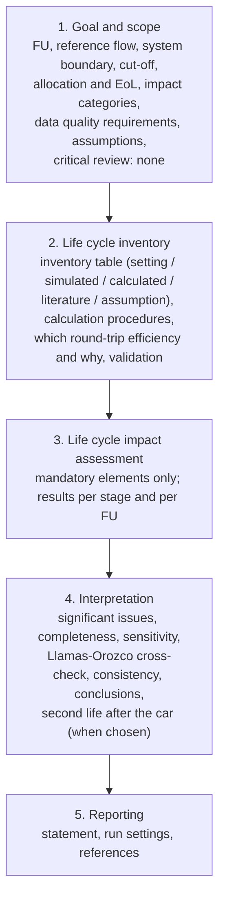

Every page carries the footer *"A screening LCA following ISO 14040/14044, not critically
reviewed"*.

---

## 9. Results at the default settings

Default settings: 20 °C ambient, forced air / passive cooling (h = 25 W/m²K), 0.3C charge,
1C discharge, 8 years in the car (2,920 cycles), 365 cycles per year, 60 kWh pack, storage depth of
discharge 80 %, SPMe (DFN for sodium-ion). The battery test (full cycles, Physics tab) gives the
rows marked "test" (and the Compare chemistries tab uses that cycle); the economics and the LCA use
the storage cycle (the same simulated cycle at 80 % depth).
TEA inputs as in Section 7.3 (retired at the threshold of highest NPV, grid fees exempt after
2029, income tax), with OMIE prices for January–September 2025 (Section 7.2). LCA: stationary,
end of service life = the TEA's retirement threshold, 15-year cap, simulated (cell) round-trip
efficiency, 117.2 g CO₂eq/kWh (Portugal 2025, Electricity Maps).

| Quantity | NMC | LFP | NCA | Na-ion |
|---|---|---|---|---|
| Simulated cell capacity [Ah] | 4.65 | 117.74 | 4.55 | 1.09 |
| Simulated cell energy [Wh] | 16.39 | 365.73 | 15.65 | 3.10 |
| Mean cell temperature while cycling [°C] (core for NMC and NCA) | 22.2 | 21.5 | 23.5 | 20.4 |
| Simulated energy efficiency [%] | 91.6 | 91.5 | 89.7 | 93.9 |
| Whole-system round-trip efficiency used in the TEA [%] | 84 | 83 | 82 | 86 |
| System cost (CAPEX) [€/kWh] | 298 | 284 | 303 | 284 |
| Cycles to 80 %, test (range ±5 °C or best/worst cell) | 376 (330–406) | 1,227 (1,125–1,331) | 867 (772–963) | 401 (401–2,001) |
| Cycles to 80 %, storage cycle | 563 | 1,852 | 1,257 | 2,259 |
| Capacity after 2,920 storage cycles [%] | 54.0 | 70.8 | 64.9 | 74.1 |
| End of life: retirement threshold of highest NPV [%] | 50 | 50 | 50 | 50 |
| NPV [€] (at that end of life, grid fees exempt, after tax) | −11,393 | −7,028 | −9,304 | −6,185 |
| LCOS [€/kWh] (before tax) | 0.275 | 0.196 | 0.222 | 0.186 |
| Retired in year (reaches 50 %, the end of the ageing data) | 10 | 15 | 14 | still working at the 15-year end (51.5 %) |
| NPV [€] if retired at 70 % instead (CFB-IND minimum) | −14,416 | −9,574 | −12,302 | −8,510 |
| Energy delivered to the end of life [MWh] | 110.3 | 186.6 | 165.2 | 199.1 |
| Carbon footprint, regulation scope [g CO₂eq/kWh] * | 26.4 | 15.8 | 16.4 | 19.4 |
| Carbon footprint incl. losses [g CO₂eq/kWh] | 36.6 | 27.4 | 29.4 | 26.9 |
| Water consumption [L/kWh] | 2.19 | 0.29 | 1.33 | 0.79 |
| Freshwater ecotoxicity [g 1,4-DCB eq/kWh] | 7.5 | 5.1 | 4.7 | 1.3 |

\* Not a conforming CFB-IND value: the end of life (50 %) is below the rules' 70 % minimum.
At 70 % the regulation-scope footprint is 60.1 (NMC), 24.5 (LFP), 29.8 (NCA) and 28.0
(Na-ion) g CO₂eq/kWh; the LCA report gives this value in its sensitivity check.

**Discussion.**

- **Lifetime ranking.** In the battery test LFP outlasts NMC by a factor of about 3.3. That is consistent with
  Ohneseit et al. (2025), whose LFP and NMC 21700 cells were cycled by the same lab under
  the same protocol (about 1,600 vs about 500 cycles to 80 %). NCA, now at the level of the
  Samsung 50E's own cycling (Section 6.5), lasts about 2.3 times as long as NMC and 0.7 times
  as long as LFP; Ohneseit measured about 1,300–1,500 cycles for their 21700 NCA cells, so
  NCA sits between NMC and LFP, as there. (With the Panasonic level of earlier versions NCA
  lasted about as long as NMC, as the Panasonic NCR18650B does in Preger et al. 2020.)
- **Lifetime drives the footprint per kWh.** LFP has a similar production footprint per kWh
  of capacity (58.5 vs 64.7 kg CO₂eq/kWh for NMC). Its footprint per kWh *delivered* is about
  1.7 times lower than NMC's, because it delivers about 1.7 times more energy before reaching
  its end of life (50 % for both at the defaults; at 70 % the factor is 2.5). Sodium-ion has the lowest ecotoxicity per kWh of capacity (4.2 kg 1,4-DCB eq/kWh) and,
  with the commercial-cell model, a slightly higher efficiency than LFP's (93.9 vs 91.5 %; the Blade's measured 1C resistance is about 1 mΩ). But at the
  default fade rate (0.05 % per full cycle) and the 80 % storage depth it fades at 0.22 of
  that rate (the depth factor, Section 6.7), so it is still working after the 15 years and
  delivers the most energy: the best NPV and LCOS and the lowest footprint incl. losses. That
  rests on the depth factor at 80 %, interpolated between full cycles and Rehm et al.'s
  20–80 % cells with no measurement in between; in full cycles (the battery test) it reaches
  80 % after 401 cycles, the shortest life. The result is the most uncertain of the four.
- **Economics.** With real 2025 prices, the daily cycle buys at a mean of €26/MWh (midday
  solar hours, sometimes below zero) and sells at €121/MWh (evening), a margin of about
  €0.09 per kWh delivered. Every day of the price data was profitable. Even so, no chemistry
  pays back a sourced system cost of €284–303/kWh with day-ahead arbitrage alone: at one
  cycle a day to 80 % depth, LFP's cash flow falls short of its €17,000 investment, and it
  reaches 50 % capacity, the end of life of highest NPV shared with the LCA, in year 15. CAPEX and the spread move the NPV
  most, then the round-trip efficiency (tornado chart). Without grid fees the best
  retirement threshold is the lowest tried, 50 %, for every chemistry: a retired battery
  earns nothing, and running on costs less than it earns. Retiring at 70 % instead lowers the
  NPV by €2.3–3.0k. (The grid-fee and income-tax effects described in earlier versions were
  computed on full cycles; run the dashboard for the current values.)
  Commercial batteries usually add ancillary services and use cells rated for several
  thousand cycles. The earlier results (LFP +€575 at an assumed 0.10 €/kWh spread and
  €95/kWh battery-only cost) were optimistic mainly because that cost left out the inverter,
  enclosure and installation, which are about 78 % of NREL's system cost.
- **Second life.** A repurposed battery saves only the pack, about 22 % of a new system's
  cost at 2025 prices, so at the defaults second life does not pay either. After 8 years and
  146,000 km in a car (0.3C charging, 20 °C) LFP leaves with 88.9 % and NMC with 89.6 %
  (both meet Euro 7). The repurposed battery costs about $49 per nameplate kWh for both, so
  the second-life system costs €266/kWh against €284/kWh for a new LFP system at 2025 prices.
  Both are bought in 2033, the year before the second life starts, at NREL's mid projection
  for that year ($257/kWh instead of $321, Cole et al. 2025, Table 2; the balance of system
  falls in proportion): €222/kWh against €227/kWh, then raised by inflation. Each system is
  retired at its own threshold of highest NPV (50 % for both at the defaults); over 8 years
  from 2034 the second-life NPVs are −€7,584 (LFP) and −€7,020 (NMC), against about −€7,300
  for a new LFP system (NREL's LFP-based 85 % round-trip efficiency): second life is €284
  worse for LFP and €275 better for NMC (NCA: €1,085 worse). Cheaper new systems leave the
  reused pack only a small saving, so the answer is close.
  For NMC it holds for the arbitrage spread ±20 % and second lives of 5–12 years; for LFP and
  NCA second life is worse in all those cases. It turns in favour of second life for all three
  if the used battery is free (repurposing only: LFP +€1,344, NMC +€1,917, NCA +€484), and
  against it if the used battery costs Dong et al.'s highest price ($180/kWh repurposed:
  LFP −€8,831, NMC −€8,258) or, for NMC, if storage used the laboratory ageing (−€1,939).
  Carbon footprint (regulation scope) per kWh delivered: car life only 126 (LFP) and 125 (NMC) g CO2eq; both
  lives with the production shared 22.2 and 20.8; the second life alone (cut-off) under 0.1; a
  new LFP system 25.1. Second life avoids making 3.5 t CO2eq of new LFP cells.
- **Car first life, compared with measurements.** The NMC car first life is scaled to fleet
  data (`ageing.EV_FIELD_SCALE`, `scripts/fit_field_ageing.py`): six Smart e.d. cars (Li-Tec
  NMC / graphite) tested on a chassis dynamometer over up to 836 days and 27,300 km (Rücker
  et al. 2024). The laboratory model loses about three times what the cars lost (RMSE 7.7
  points); calendar loss × 0.56 and cycling loss × 0.22 fit the 12 tests at 12 °C or warmer
  to 1.5 points, about the 2 % precision of such tests. The same factors also fit a laboratory
  test with fast charging (below), so they mostly say that automotive NMC cells age more
  slowly than the LG M50 and HG2 cells behind the model, not only that cars rest. Cars not in the fit: the VW ID.3 test car of Schreiber et al.
  (60,000 km in 3.5 years) measured 98.0 %, the model gives 94.3 % (87.8 % before); two
  Peugeot iOn (GS Yuasa LEV50) measured 87.2 % and 93.7 %, the model gives 95.0 % for both. So
  the fitted model sits between an older cell (iOn) and a modern one (ID.3). LFP and NCA cars
  keep the laboratory model. For LFP that is supported by one car: the TUM 2020 Tesla Model 3
  (LFP) kept 91.9 % of its capacity (159.6 → 146.7 Ah, Bilfinger et al. 2025, Supplementary
  Table 1; 91.8 % recounted here from the released slow full charges, `data/bilfinger2025`)
  between 1,000 and 80,100 km, about four years. The unscaled model gives 94.4–91.4 % for four years at
  54 km a day and 10–20 °C, almost all of it calendar loss, so it is if anything slightly
  optimistic, not pessimistic like the NMC model. NCA has no field data yet.
- **Second-life fade, compared with measurements.** In storage (1C, full cycles) the model
  loses 10 % (LFP) and 4.6 % (NMC, with the car cells' field factors; 28 % with the
  laboratory model) per 1,000 cycles after leaving the car. On a gentle cycle (C/4, 25–75 %
  SOC, one a day, 25 °C) it loses 3.2 % (LFP) and 3.7 % (NMC). Retired Nissan Leaf
  cells (LMO / graphite, a different chemistry) faded far more slowly in published
  second-life tests: about 4 % per 1,000 cycles at 0.2–1C (Gao et al. 2024), at least 2,033
  equivalent full cycles before the knee (Braco et al. 2020), and no measurable fade over
  15 months in a 3–4 V window (Cui et al. 2024). On a similarly gentle cycle the second
  lives of both LFP and NMC are in the same range. The dashboard's default (1C,
  80 % depth) is a harder duty than those tests.
- **Fast charging, compared with measurements.** The car's daily charges can be partly DC fast
  charges (sidebar). A fast charge is a trip from 80 % down to 20 % and a charge back to 80 %
  at 1.2C (a 20–80 % charge in about 30 minutes), with the pack pre-conditioned to 25 °C while
  charging; it moves the same charge per day as a normal day, so it comes every few days, and
  the cycling losses of normal and fast charges are mixed by their share. Schreiber et al. (2025) tested the
  ID.3 cell on a highway profile with a DC fast charge every cycle (about 1,100 fast charges
  by the knee): 92.2 % after 448 cycles (160,000 km). The laboratory NMC model gives 76.1 %
  (6 of its 24 points from fast charging); with the field factors fitted to the Smart fleet,
  94.1 %, without refitting. At the dashboard's default use (50 km a day, 20 °C) fast charging
  changes little for NMC and LFP: NMC leaves the car with 89.6 % without and 87.0 % with every
  charge a fast charge, LFP 88.9 and 87.4 % (the deeper 20–80 % window, not the rate: the LFP
  model adds rate wear only above 2.3C, Severson et al. 2019). NCA drops from 85.6 to 75.0 %:
  1.2C is above the Samsung 50E's 1C maximum, and its charge-rate term (Huang et al. 2026,
  Section 6.5) doubles the wear at 1C and 25 °C, so this is an extrapolation.
- **Storage ageing, compared with field data.** 21 German home storage systems measured over
  up to 8 years (Figgener et al. 2024: about 200 full cycles a year, mostly shallow, low
  C-rates, indoors) lost on average 1.9 (NMC) and 2.0 (LFP) percentage points of capacity a
  year from their operating data, 3.2 and 2.2 from on-site capacity tests, with about 2
  points of spread between similar systems. On a home storage day (`scripts/fit_field_ageing.py`)
  the storage model loses 2.8 (NMC) and 1.5–1.6 (LFP) points a year between years 2 and 8 at
  20–25 °C: inside the field range for NMC, slightly below it for LFP. So the storage model
  is not scaled. What the field data cannot check is the model's NMC loss in the first two
  years (16 % on this day): the measurements started after commissioning and the systems keep
  a hidden capacity reserve.

These numbers are generated with the same functions as the dashboard and can be reproduced
there.

---

## 10. Validation and known limitations

### 10.1 Validation summary

```mermaid
flowchart TB
    subgraph PHY["Physics model"]
        V1["NMC lithium loss vs Kirkaldy 2024<br/>train 0.40, test 2.56 %-points RMSE"]
        V9["NMC 1–5C vs Catenaro 2021<br/>capacity ±0.07 Ah, can temperature 3.8 K RMS"]
        V0["Na-ion discharges vs Schneider 2025<br/>18–49 mV RMSE, C/100–5C;<br/>warming 2.9 vs 3.2 K (1C)"]
        V7["NCA discharges vs Schmitt 2023<br/>capacity ±1 %, 15–24 mV, 0.04–1C;<br/>two 50E cells: capacity ±1 %, 0.75C warming"]
        V8["LFP (BYD Blade): Blade pulse resistance ±0.05 mΩ; BYD 4680 10–14 vs 6–17 Ω·cm²<br/>R(T) within 4 % (280 Ah cell)"]
    end
    subgraph EMP["Empirical ageing"]
        V2["NMC: 24 conditions, ×1.38<br/>held-out Kirkaldy: 1.0–1.5 %-points;<br/>42 MJ1 cells: 4.9 %-points (≤ 0.5C charge)"]
        V3["NCA: Preger, 8 of 9 within ≈15 %;<br/>50E level 0.63 %-points; 1,470 vs 1,300–1,500;<br/>50E charge rate (Huang): 2.2 %-points"]
        V4["LFP: Ohneseit level; Severson ×1.27;<br/>knee: 2.7 vs 6.9 %-points;<br/>280 Ah cell, 700 cycles: 1.4 %-points"]
        V11["Field: Smart fleet 1.5 points (fitted),<br/>ID.3 car and cell, Tesla Model 3,<br/>21 home storage systems"]
        V5["Na-ion: 2 layered-oxide cells to 80 %<br/>(Liu 2026); 20–80 % depth (Rehm 2026)"]
    end
    subgraph EST["SOC and SOH estimation"]
        V10["Tesla Model 3 charge: 3.1 points RMS<br/>home storage, 83 days: 2.3 points;<br/>capacity within 2 %; drive cycles 0–40 °C:<br/>1.4–4.9 points (US06 7.6–14)"]
    end
    subgraph SW["Software"]
        V6["128 automated tests (pytest, CI)"]
    end
    PHY ~~~ EMP ~~~ EST ~~~ SW
```

- **NMC physics** is calibrated to measured LG M50T data (Kirkaldy et al., J. Power Sources
  603, 2024, cycled at 70–85 % state of charge): lithium loss within 0.5 %-points at 28–41 °C;
  2.6 %-points too low at 16 °C (not used in the fit). `python scripts/validate.py`. The
  dashboard shows this comparison under "How accurate is this?". Self-heating and round-trip efficiency against
  six LG M50 cells (Catenaro & Onori 2021): with the fitted electrolyte factor and the core/can
  temperatures, capacity within 0.07 Ah and can temperature within 3.8 K RMS from 1C to 5C in
  the 25 and 35 °C chambers, efficiency within about 3 points up to 3C; 0.3–0.6 Ah too much
  capacity in the 5 °C chamber (Section 4.3).
- **NMC ageing model:** fitted to 24 measured conditions (0–40 °C, 0.33–1.67C charge,
  three labs); typical error x1.4 in cycles to 80 %. It reproduces the main trends:
  5/3C charging at 0 °C fails in about 40 cycles (measured 41), 1C at 25 °C about 300 (282),
  and charging at 40 °C is nearly unaffected by the rate. On the Kirkaldy 70–85 % window
  (not used in the fit) the error is 1.0–1.5 %-points (BLAST-Lite's original: 7–12).
  Worst points: 5/3C at 40 °C (model 395 vs 635), 20–80 % cycling (844 vs 1,650; those cells
  ranged 780–2,150), Wittman's 15 °C cells (303 vs 170). Luh & Blank also show that avoiding
  the bottom 10 % of charge extends life several times; the model's depth-of-discharge term
  cannot capture that. Charging above 5/3C is an extrapolation (the dashboard warns). On 42
  LG MJ1 cells (TUM) it is within 4.9 %-points for charges at 0.5C or slower and right at 10 %
  depth, but those silicon energy cells, charged at 0.66C or faster over half or more of
  their capacity, lost about half their capacity in a few hundred cycles where the model
  gives 16 % (the dashboard warns).
- **NCA ageing model:** its depth effect is fitted to the Panasonic
  NCR18650B, within about 15 % of Preger's cycles to 80 % for 8 of 9 tests (0–100 % at 0.5C:
  350 vs 240), and its level to the Samsung 50E, the physics model's cell (0.63 %-points RMS
  over 530 full cycles; Section 6.5). It then gives 1,470 cycles at 20 °C, 1C, where Ohneseit
  et al. measured about 1,300–1,500 on 21700 NCA cells. It does not capture the knee and the
  sudden failure that 50E cells showed after 390–430 cycles when charged without a CV hold or
  held at 2.5 V. Charging at 1C ages the 50E about twice as fast at 23 °C and barely faster at
  40 °C (Huang et al. 2026, 2.2 %-points RMS); the model's 40 °C fade at 0.5C is too slow (14.5
  vs 18 % at 750 cycles), the 2C discharge's earlier end at 23 °C is missed, and at 0 °C the
  cells failed within 50 cycles at every rate (outside the model's range; a warning).
- **Sodium-ion physics** is a commercial cell (Mushang NA18650-1250) parameterised by Schneider
  et al. (2025). Against their measured discharges from C/100 to 5C at 25 °C the model's
  voltage error is 18–49 mV RMS (theirs: 10–52 mV), capacity within 2 % and temperature rise
  2.9 vs 3.2 K at 1C and 15.4 vs 17.2 K at 5C. Round-trip efficiency is about 2 percentage
  points above Rehm et al.'s (2025) measurements on the same cell (1C, 25 °C: 93.9 % vs
  89–92 %; 0.67C: 95.3 % vs 93.6 %), because the model has a single open-circuit curve and no
  voltage hysteresis. The paper validated discharges only; charging is less certain. The
  temperature dependence was measured at 10–40 °C; below 10 °C it is extrapolated, and the
  simulated efficiency falls quickly (0.3C/1C cycle: 88 % at 10 °C, 79 % at 5 °C). When
  charging fast in the cold the anode surface fills up and the solver may stop: the program
  retries with other particle meshes (`SODIUM_MESH_STRETCHES` in `chemistry.py`), then reports
  a clear error.

  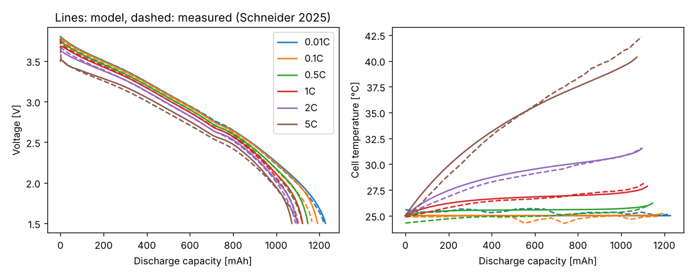

- **Sodium-ion ageing** is a straight line per cycle, default 0.05 %/cycle (layered-oxide
  18650 cells, Liu et al. 2026, measured to 80 %); below 80 % it is an extrapolation. Cycles
  of 60 % depth or less fade 20 times slower (Rehm et al. 2026, the physics model's cell at
  20–80 %); shallower depths have no data, so the 60 % value is held. Early
  commercial cells vary a lot between makers and batches (0.008–0.05 %/cycle in Liu et al.),
  so the rate is a sidebar input. No temperature dependence is applied (Klick et al., Batteries
  & Supercaps 2025, saw similar fade at 25 and 40 °C on a commercial sodium-ion cell).
- **LFP** physics (BYD Blade) and ageing (Sony-Murata) come from different cells of the same chemistry.
  The Sony-Murata model gave about 8,000 full cycles to 80 %; its cycling term is scaled so
  that 0–100 % cycling at 20 °C and 1C matches the 21700 LFP cell of Ohneseit et al. (about
  1,600; 2C: model 1,590 vs about 1,750). NMC is scaled to the same study, so LFP now lasts
  about 3× longer than NMC (dashboard defaults: 1,227 vs 376 cycles). Durable cells can
  do much better: Preger's A123 18650 cells reached an estimated 6,400–8,800 (mostly
  extrapolated), so treat LFP life as typical, not best-in-class. Ohneseit's LFP cells also
  showed a sudden drop after about 2,200 cycles, which the model does not capture at slow
  charge rates (see the knee below).
  Fast charging: life is unchanged up to about 2.3C (charge-weighted mean rate) and then
  falls steeply, fitted to Severson's A123 cells (3.6–8C, 30 °C; typical error x1.27 over
  82 cells). Severson's 2017-06-30 batch was left out because the same charging policies
  gave much shorter lives than in the other two batches. There are no data between 0.5 and
  3.6C for this cell, and none for LFP fast charging below 30 °C; the model has no cold-charge
  penalty for LFP, so cold results are optimistic (the dashboard warns below 20 °C).
  Checked against 700 cycles at 1C of a 280 Ah LFP storage cell at about 40 °C (Gray & Vagg
  2026; `scripts/validate_blade.py`): the model gives 90.0 % capacity left, measured 92.9 %
  (1.4 %-points RMS over the 14 check-ups), so it is slightly pessimistic for that cell.
- **LFP knee** (`python scripts/validate_lfp_shape.py`, figure below): Severson's cells
  measured cycle by cycle (123 cells; the cycle-by-cycle file comes from the copy in Thelen
  et al.'s repository, see Section 14) stay nearly flat and then drop sharply (a knee): at
  half its life a measured cell has done a median 9 % of its fade to 0.88 Ah. The power law
  of the Sony-Murata model fades almost in a straight line (47 %). The cycling loss is
  therefore bent around 20 % loss, where cycle life is fitted, so life stays where it was:
  L_knee = 0.2 (L / 0.2)^κ, smaller before 80 % and larger after. κ = 3.31 is fitted to the
  capacity curves of the 81 cells of the fitted batches (`scripts/fit_ageing.py`, step 0):
  median RMSE over the measured life 2.7 %-points of nominal (6.9 without the knee), fade done
  at half of life 15 % (measured 9 %), cycle-life error ×1.28. The knee comes with fast-charge
  wear, the most common knee mechanism (lithium plating, Attia et al. 2022): κ applies in
  proportion to the fast-charge share of the cycling loss, 1 + (κ − 1)(1 − 1/F), with F the
  fast-charge factor of the model. Slowly charged LFP measured so far fades steadily — the
  280 Ah cell's 700 cycles (above) and 21 home storage systems (below). A knee at every charge
  rate moved both away from the data (home storage 0.8–0.9 instead of 1.5–1.6 points a year,
  field 2.0–2.2; the 280 Ah cell 95.6 % instead of 90.0 %, measured 92.9 %), so below about
  2.3C there is no knee and the results above are unchanged. Ohneseit's slow-charge drop
  after 2,200 cycles is the evidence that knees happen there too, later; it is not enough to
  fit one.

  

- **NCA physics** is a commercial cell (Samsung INR21700-50E) parameterised by Schmitt et al.
  (2023). Against their measured discharges at 25 °C it is within 1 % in capacity and 15–24 mV
  RMS in voltage at 0.04C, 0.5C and 1C (`scripts/validate_nca.py`; the paper's own isothermal
  model was 4.5 % short at 1C). Not given in the paper and taken from elsewhere: the thermal
  properties (Chen 2020, also a 21700 cell) and the electrolyte (Landesfeind & Gasteiger 2019
  for EC:EMC 3:7 instead of the cell's EC:DMC, about 10 % lower conductivity). The paper's
  exchange-current fits do not reproduce its measurements, so the measured points are used.
  **Checked against two 50E cells** (`scripts/validate_nca_thermal.py`, data in
  `data/popp2024`; Univ. Wuppertal, 25 °C chamber, thermocouple on the middle of the can).
  With h fitted to the 0.5C charge (36 W/m²K in their holder; can temperature of the core/can
  model):

  | Step | Rise, cells [K] | Rise, model [K] | Charge, cells [Ah] | Charge, model [Ah] |
  |---|---|---|---|---|
  | 0.5C charge from empty (fitted) | 1.3 / 1.8 | 1.55 | 4.21 / 4.21 | 4.26 |
  | C/5 discharge from full | 1.1 / 1.4 | 0.30 | 4.84 / 4.80 | 4.87 |
  | 0.75C charge from empty | 2.4 / 3.2 | 3.31 | 3.95 / 3.95 | 3.95 |

  Capacity is within 1 % and the 0.75C warming matches the warmer cell. At C/5 the model
  warms a quarter as much as the cells: its parameter set has no entropic (reversible) heat,
  which dominates at low current. Measured entropy coefficients of the 50E would fix it.

  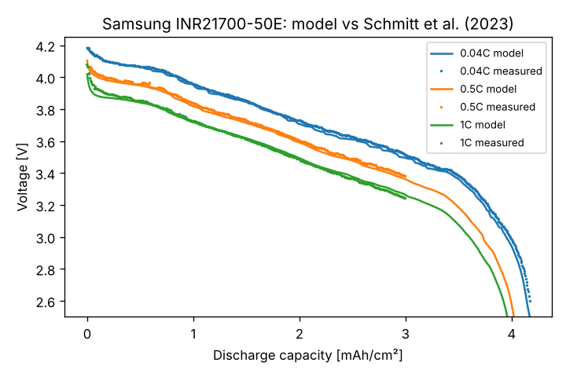

- **LFP physics** is a commercial BEV cell, the BYD Blade (135 Ah), built from the teardown of
  Gorsch et al. (2025): coatings, foils, separator, number of layers, electrode sizes (Fig. 5),
  component masses (Fig. 7) and capacity. The 0.9 m long foils add 0.28 mΩ, computed from
  their size (Ohm's law, current collected along each sheet). Nobody has published the
  Blade's electrode properties, so the electrochemistry starts from Prada 2013 (with the
  graphite OCP of Mohtat et al. 2020, and graphite diffusion with the 25.3 kJ/mol activation
  energy Schmitt et al. 2023 measured) and five values are fitted, one per measurement
  (`scripts/fit_blade.py`):

  | Fitted value | Measurement | Result |
  |---|---|---|
  | LFP OCP level (+26 mV on Afshar's curve) | pseudo-OCV of a 280 Ah LFP cell, 10–90 % SOC (Gray & Vagg 2026) | 8.9 mV RMS |
  | Graphite exchange current, BYD 4680 (×10.1 Chen 2020) | charge-transfer resistance of the BYD 4680 LFP cell, 5.9 Ω·cm² (Liu et al. 2025) | exact |
  | LFP hysteresis (±31 mV, PyBaMM one-state model) | gap between the C/10 charge and discharge curves of the 280 Ah cell, minus its measured resistance | – |
  | Graphite diffusivity (3.9·10⁻¹⁵ m²/s at 25 °C; Prada 3·10⁻¹⁵, constant) | BYD 4680 rate test: 1C and 2C capacity / C/2 (94.7, 87.9 %) | 95.2, 87.9 % |
  | Graphite exchange current, Blade (×1.38 Chen 2020) | the Blade's own 18 s 1C pulse resistance at 20 °C, 0.96–1.15 mΩ at 90–20 % SOC (Gorsch Fig. 8C, `scripts/digitize_gorsch.py`) | mean exact, 0.05 mΩ RMS |

  The 4680 is a power cell, so its graphite reacts about seven times faster than the
  Blade's. A fitted constant resistance would also match the Blade's pulse level, but would
  halve the temperature dependence (only the foils are temperature-independent).

  Checks with data not used in the fit (`scripts/validate_blade.py`, figure below):
  10 s 1C pulse resistance of the BYD 4680 10–14 Ω·cm² across 80–20 % SOC (measured 6–17);
  resistance at 15 and 35 °C relative to 25 °C 1.26 and 0.82 (280 Ah cell: 1.31 and 0.81);
  C/10 capacity at 15 and 35 °C relative to 25 °C 0.995 and 1.004 (280 Ah cell: 0.989 and
  1.005; flat before diffusion got its temperature dependence); C/10 discharge voltage within
  10 mV RMS of the 280 Ah cell; the Blade's C/10 capacity and energy 134.0 Ah and 432 Wh
  (Gorsch: 135 Ah, 432 Wh); its pulse resistance 1.27 times higher at 20 % than at 90 % SOC
  (measured 1.19); the 4680's C/2 capacity 14.6 Ah (measured 15.0). Heat capacity of the
  lumped model 818 J/(kg·K), 7 % below the A123 LFP cell's 884 (Lin et al. 2014).
  Not checked: the Blade's rate capability (no data; the model gives 89 % of its C/10
  capacity at 1C, 25 °C, limited by graphite diffusion fitted on the 4680) and its
  resistance at 10 and 40 °C (Gorsch Fig. 8A is a 3D surface and was not read).

  Assumptions and their weight (`scripts/sensitivity_blade.py`, dashboard default cycle,
  each changed alone with the fitted values kept): cathode binder + carbon 2–10 % of the
  volume (porosity 0.21–0.13) moves the efficiency 90.6–91.7 % (default 91.5 %); the cell
  mass 2.7 ± 0.3 kg (Gorsch), which scales both electrode masses, 89.2–92.1 % and the peak
  temperature by up to 1.5 K; the separator porosity (0.35–0.55) and the speed of the
  hysteresis switch (over 1.5–15 % of the capacity) by under 0.3 points. The 1C capacity
  changes by under 0.3 Ah in every case. Refitting to the measured pulse resistance after
  each change would pull the efficiency back, since that resistance sets most of the loss.

  

- **Shaded range:** the capacity chart shows the result for a cell 5 °C cooler and 5 °C hotter
  (lithium) or for the best and worst measured commercial cells, 0.01–0.05 %/cycle (sodium-ion).
  It shows how sensitive the result is to that input, not a statistical confidence interval.
- All curves stop at 50 % capacity, where the data end. The dashboard warns whenever the
  temperature, charge/discharge rate or cycle count is outside the measured conditions. The
  default settings (20 °C, 0.3C charge, 1C discharge) are inside the data for NMC, LFP and NCA.
- **Assumed inputs.** The recycling credit, the cells' specific energy and the grid carbon
  intensity are assumptions. System costs (Section 7.3) and the production carbon, water
  and ecotoxicity factors (Degen et al. 2024, Section 8.3) are sourced.

### 10.2 Further methodological limitations

- **Representative cycle.** The ageing projection assumes that the last simulated cycle
  repeats unchanged. In reality the cell's resistance grows and its temperature and voltage
  limits are reached earlier, which changes the stress factors. The aged windows of the
  Physics tab show this effect, but it is not fed back into the projection.
- **Additive mechanisms.** Calendar and cycling losses are added. Interactions (for example,
  plating that accelerates SEI growth) are not modelled; the only knee is LFP's under fast
  charging (Section 10.1).
- **Chemistry mismatch between models.** For LFP (BYD Blade vs Sony-Murata vs Ohneseit 21700), NCA
  (Samsung 21700-50E vs Panasonic 18650B) and sodium-ion (Mushang NFM physics vs other NFM ageing cells
  vs NaNFM442 LCA data), the physics, the ageing and the LCA data describe different cells of
  the same chemistry.
- **Data extraction.** The 46 published ageing points and several physics parameters were read
  from figures, which adds a reading error of the order of a few percent. The newer checks
  (Catenaro, Severson's curves, REBELION, the Wuppertal cells, the Tesla and the home storage
  system) use the raw data.
- **Single-cell scale-up.** The pack is the cell times the number of cells. There is no
  cell-to-cell variation and no balancing. The temperature spread along a coolant channel
  is shown in the Physics tab (Section 4.7) but does not feed the economics or the LCA.
- **LCA.** Screening level: secondary data, cell level only, no Circular Footprint Formula,
  no critical review, and no normalisation or weighting. Not suitable for public comparative
  assertions.
- **TEA.** One year of hourly prices is repeated over the whole project, with no price
  trend other than inflation. The daily dispatch has perfect foresight of the day's prices, so the revenue is an upper
  bound for day-ahead arbitrage. Prices and grid fees rise with Banco de Portugal's inflation
  projections to 2028, then 2 %.
  Other limitations: no degradation of the efficiency, no replacement, no subsidies, no
  disposal cost and no ancillary services. The tax model is simplified (no derramas; the
  battery system's depreciation category is the closest listed one, as batteries are not
  listed) and the grid-fee rule after 2029 is unknown. Costs are US (NREL) and global
  (Benchmark) values converted to euro; European system costs may differ. The discount rate is for onshore wind, which is
  probably less risky than merchant storage. The structure follows ISO/TS 14076,
  IEC 60300-3-3 and ISO 15686-5 as far as their public contents show; conformity with
  their full text has not been checked.

### 10.3 Updating the twin with measured capacity

The expander "Update with your own measurements" (Physics tab) takes measured capacities of
a cell used like the simulated one and adjusts the prediction (`battery_twin.update`). The
predicted capacity loss is multiplied by one factor $k$, chosen to minimise

$$\sum_i \frac{\left(q_i - [1 - k\,L(n_i)]\right)^2}{\sigma^2} + \frac{(\ln k)^2}{s^2},$$

where $q_i$ is the measured capacity at cycle $n_i$, $L(n)$ the predicted loss,
$\sigma = 0.02$ the assumed measurement and model error, and $s = \ln 1.27$ the typical
error of the LFP fast-charge fit. This is the most likely $k$ under Gaussian errors and a
log-normal prior: the twin's prediction is the starting point and the data move it only as
far as they justify. It is a one-parameter version of the particle filter in Thelen et al.
(2023), which starts from a power law with no model behind it.

**Test** (`python scripts/evaluate_update.py`), following the protocol of otwin-hybrid
(Marin 2026): each method sees only the first N cycles of a cell and predicts the rest, and
every method is compared with two baselines that know nothing about batteries (persistence:
capacity stays at its last value; linear drift). $\sigma$ was chosen on Severson's 41
"Train" cells (lowest RMSE on the unseen cycles); the table is for the 82 test cells.

| Seen | Method | Life error (median factor) | RMSE on unseen cycles | Skill vs persistence |
|---|---|---|---|---|
| 100 cycles | twin | ×1.28 | 4.7 %-points | 0.72 |
| | twin + update | ×1.27 | 4.7 | 0.74 |
| | power law (data only) | never reaches 80 % for 95 % of cells | 6.1 | 1.00 |
| 300 cycles | twin | ×1.28 | 6.3 | 0.94 |
| | twin + update | ×1.20 | 4.5 | 0.74 |
| | power law (data only) | ×4.3 | 6.0 | 0.99 |
| | linear drift | ×5.8 | 5.3 | 0.85 |
| 500 cycles | twin | ×1.19 | 7.3 | 1.06 |
| | twin + update | ×1.18 | 2.9 | 0.47 |

On the six Kirkaldy NMC cells (70–85 % cycling, first half of each test seen), the RMSE over
the second half falls from 1.43 %-points (twin) to 0.63 (update); persistence gives 2.05,
linear drift 1.57 and the power law 0.50.

What this shows:

- **Curves fitted to the data alone cannot predict LFP life from early cycles.** The cells
  are nearly flat until a late knee, so after 100–300 cycles a power law or a straight line
  usually never reaches 80 %. The twin, which knows the charge rate, does.
- **The update tracks the measured capacity best**, for LFP and NMC.
- **With the knee in the model, the update also gets LFP life right.** Without it, the flat
  early data pulled $k$ down (median 0.29 after 500 cycles) and the life came out ×1.6–2.6 too
  long; now $k$ stays near 1 (median 0.92 after 100 cycles, 0.60 after 500) and the updated
  life is within ×1.18–1.27, slightly long on average (median ratio 1.06–1.11). The dashboard
  still shows the updated curve beside the prediction and does not pass it to the economics
  or the LCA.
- Choose the metric that matches the decision (Marin 2026): the update is better for the
  capacity over the next cycles; for the end of life both are now close.

---

## 11. Software implementation, testing and reproducibility

### 11.1 Repository layout

```
app.py                      Streamlit dashboard
src/battery_twin/
    chemistry.py            chemistry table, PyBaMM physics, battery test
    ageing.py               empirical ageing models and validity warnings
    sources.py              all published sources (shown in the Sources tab)
    economics.py            TEA        environment.py   LCA
    lca_report.py           screening LCA report (PDF or Word, ISO 14040/14044 structure)
    tea_report.py           TEA report (PDF or Word, ISO/TS 14076 structure)
    report_doc.py           one report content rendered as PDF (ReportLab) or Word (python-docx)
    constants.py            values shared by several modules (data folder, CFB-IND end of life)
    calibration.py          NMC physics calibration against Kirkaldy et al. 2024
    severson.py             Severson et al. 2019 cells: test cycle, measured and model curves
    update.py               measurement update of the predicted capacity (Section 10.3)
    estimator.py            SOC and SOH estimation (Section 4.8)
    pack.py                 temperature spread along a coolant channel (Section 4.7)
    lfp_blade_params.py, nca_params.py, sodium_ion_params.py
                            parameter sets of the BYD Blade, Samsung 50E and Mushang cells
    data/                   measured and published data; each folder has a README with
                            its source and licence (credits in Section 14)
        calibration.json            result of the NMC calibration
        ageing_fit.json             fitted ageing constants (scripts/fit_ageing.py)
        published_ageing.csv        46 points read from published ageing studies
        severson2019_cycle_life.csv Severson et al. 2019, Supplementary Table 9 (124 cells)
        severson2019_capacity.csv   the same cells' capacity every 10th cycle (123 cells)
        lca_degen2024.csv           production impacts per kWh, Degen et al. 2024
        omie_prices_pt_<year>.csv   hourly OMIE day-ahead prices, Portugal
        kirkaldy2024/               NMC calibration data (6 LG M50T cells)
        catenaro2021/               LG M50 discharges at 1-5C, 5-35 °C (thermal, high rate)
        rebelion2024/               Samsung 50E cycle ageing (NCA level)
        popp2024/                   Samsung 50E capacity and self-heating
        gorsch2025/, gray2026/      BYD Blade and 280 Ah LFP cell data
        schmitt2023/, schneider2025/  NCA and sodium-ion discharge curves
        bilfinger2025/, rucker2024/ Tesla Model 3 charges, Smart e.d. fleet
        figgener2024/               a year of a home storage system (SOC/SOH check)
    _vendor/blast_lite/     subset of NREL BLAST-Lite (BSD-3-Clause), patched for NumPy 2
scripts/                    fits, checks and studies (Section 11.3); outputs go to ./results
tests/                      pytest suite (physics, ageing, economics, estimator, dashboard)
```

### 11.2 Main functions

| Function | File | Purpose |
|---|---|---|
| `choose_model`, `build_model`, `build_experiment`, `run_simulation` | chemistry.py | Model choice, PyBaMM model, protocol and solution → DataFrames |
| `run_battery_test` | chemistry.py | Physics (10 cycles) + ageing projection (20,000 cycles) + range + warnings |
| `run_aged_window`, `cycle_windows` | chemistry.py | Aged-cell simulations for the Physics tab |
| `cooling_conditions` | chemistry.py | Cooling option → (h, temperature while cycling) |
| `add_rest`, `predict_capacity`, `validity_warnings` | ageing.py | Real-time cycle period, closed-form capacity fade, range checks |
| `cycles_to`, `cut_at_data_end` | ageing.py | First cycle below a capacity level (one definition for the whole program); curve cut where the data end |
| `daily_arbitrage`, `arbitrage_prices` | economics.py | Best daily cycle from hourly prices; mean buying and selling prices |
| `system_capex_eur_kwh`, `second_life_capex_eur_kwh` | economics.py | Sourced system costs in euro |
| `calculate_tea`, `sensitivity`, `second_life_vs_new` | economics.py | Cash flows, NPV, IRR, payback, LCOS; second life against a new LFP system, each retired at its own highest-NPV threshold |
| `with_defaults` | economics.py | TEA inputs completed with the defaults of `calculate_tea` (one place for them) |
| `best_retirement` | economics.py | NPV for each retirement threshold and the best one |
| `update_scale`, `updated_curve`, `read_measurements` | update.py | Measurement update of the predicted capacity |
| `estimate`, `ekf`, `rest_capacities` | estimator.py | SOC (Kalman filter) and SOH (capacity between relaxed rests) from noisy current and voltage |
| `coolant_temperatures`, `pack_ageing`, `mean_heat_w` | pack.py | Coolant warming along a channel; ageing of each cell |
| `severson_cycle`, `load_curves`, `model_curve` | severson.py | Severson test cycle, measured curves, model at the same policy |
| `total_energy_kwh`, `calculate_lca` | environment.py | CFB-IND total energy, impacts per phase and per FU |
| `lca_results`, `sensitivity`, `build_lca_report` | lca_report.py | LCA case, sensitivity table, PDF or Word report |
| `build_tea_report` | tea_report.py | TEA report with abstract (PDF or Word) |
| `Report` | report_doc.py | Headings, paragraphs and tables rendered as PDF or Word |

### 11.3 Scripts

| Script | Output |
|---|---|
| `scripts/run_single.py` | One battery test, printed |
| `scripts/study_temperature.py`, `scripts/study_charge_rate.py` | Parameter studies (results/) |
| `scripts/export_csv.py` | CSV export of a run |
| `scripts/calibrate.py` | NMC calibration → results/calibration.json and calibration_fit.png |
| `scripts/validate.py` | Physics and empirical NMC models vs Kirkaldy data → results/model_vs_measured.csv |
| `scripts/fit_ageing.py` | Refitted ageing constants → results/ageing_fit.json, and a measured-vs-model table |
| `scripts/fit_blade.py` | The five fitted values of the LFP (BYD Blade) parameter set, printed |
| `scripts/fit_field_ageing.py` | The field factors of the NMC car first life (Smart e.d. fleet, Rücker et al. 2024), the checks on the ID.3 and iOn cars, the LFP check on the TUM Tesla Model 3, the storage model vs 21 home storage systems (Figgener et al. 2024) and fast charging vs the ID.3 highway test (Schreiber et al. 2025), printed |
| `scripts/sensitivity_blade.py` | How much each assumed LFP value moves capacity, efficiency and temperature → results/blade_sensitivity.csv |
| `scripts/digitize_gorsch.py` | The Blade's pulse resistance from Gorsch Fig. 8C → data/gorsch2025/blade_dcr_20C.csv |
| `scripts/validate_blade.py` | LFP physics and ageing vs BYD 4680 and 280 Ah LFP data → results/blade_validation.csv, docs/blade_validation.png |
| `scripts/extract_gray2026.py` | Small CSVs in data/gray2026/ from the Gray & Vagg Zenodo files |
| `scripts/extract_catenaro.py`, `scripts/validate_thermal.py` | NMC self-heating and round-trip efficiency vs Catenaro & Onori 2021 → data/catenaro2021/nmc_tests.csv, results/thermal_validation.csv |
| `scripts/fit_electrolyte.py` | NMC electrolyte diffusivity factor from Catenaro's 2C and 3C capacities (grid), with the 5 °C check, printed |
| `scripts/check_plating.py` | Physics plating of the detailed NMC model vs Luh & Blank's cold and fast-charge tests → results/plating_check.csv |
| `scripts/validate_hysteresis.py` | SOC filter with and without the hysteresis term on partial LFP cycles, printed |
| `scripts/validate_nca.py`, `scripts/validate_sodium.py` | NCA and sodium-ion physics vs measured discharges → docs/nca_validation.png, docs/sodium_validation.png |
| `scripts/validate_estimator_tesla.py` | SOC filter on the TUM Tesla Model 3 charges (2021 vs 2025); rebuilds data/bilfinger2025/charge_<year>.csv from the .feather files |
| `scripts/validate_estimator_drive.py` | SOC filter on HG2 drive cycles at -20 to 40 °C (Kollmeyer 2020); rebuilds data/kollmeyer2020 from the cycler's CSV files |
| `scripts/validate_nmc_mj1.py` | NMC ageing model vs 42 TUM LG MJ1 cells (depth, temperature, charge rate), printed |
| `scripts/validate_estimator_storage.py` | SOC filter and rest-to-rest capacity on a year of a home storage system (Figgener et al. 2024); rebuilds data/figgener2024/system10_2022_1min.csv.gz from the monthly files |
| `scripts/extract_rebelion.py` | Capacity of every discharge of eight Samsung 50E cells (REBELION) → data/rebelion2024/nca_50e_cycling.csv |
| `scripts/validate_nca_thermal.py` | NCA physics vs two Samsung 50E cells: capacity and self-heating; rebuilds data/popp2024/samsung50e_steps.csv from the 1 kHz files |
| `scripts/validate_lfp_shape.py` | LFP curve shape (knee) vs Severson's cycle-by-cycle data → results/lfp_shape_severson.csv, docs/lfp_shape_severson.png |
| `scripts/evaluate_update.py` | Measurement update vs baselines (Severson LFP, Kirkaldy NMC) → results/update_evaluation.csv |
| `scripts/import_severson_curves.py` | Rebuilds data/severson2019_capacity.csv from the files in acthelen/battery_digital_twin |
| `scripts/download_omie_prices.py` | One year of hourly OMIE prices for Portugal → src/battery_twin/data/omie_prices_pt_<year>.csv |

### 11.4 Verification (automated tests)

128 tests (`pytest -q`, about 4 min) run on every push through GitHub Actions
(`.github/workflows/tests.yml`, Python 3.12):

| File | What it verifies |
|---|---|
| `test_physics.py` | Capacity falls with cycles; hotter cells grow more SEI; Coulombic efficiency ≤ 100 %; sodium-ion, NCA and LFP match their commercial cells (capacity, efficiency; sodium-ion self-heating; LFP pulse resistance in the BYD 4680's measured range) and a warmer sodium-ion cell is more efficient; NMC capacity matches the measured 4.857 Ah and the calibration file is used; NMC delivers the measured 4.45 Ah at 3C, while a discharge a model cannot follow (NCA at 3C) is an error; the NMC core is warmer than its can and the detailed model plates lithium when charged cold; the NCA model's C/5 capacity and 0.75C warming match two Samsung 50E cells; first, middle and last windows |
| `test_ageing.py` | Closed form matches BLAST-Lite stepping; published cycles to 80 % (Preger, Wittman, Ohneseit, Luh & Blank, Severson) are reproduced within stated bounds; trends (shallow cycling, heat, fast/cold charging, rest); the LFP knee keeps cycle life, lowers mid-life fade under fast charging and leaves slow charging unchanged; NCA at the Panasonic level reproduces Preger and at the 50E level gives 1,200–1,900 cycles; the 50E's charge rate at 23 and 40 °C (Huang); the NMC model on 42 TUM MJ1 cells and the fast-charge warning; sodium-ion fade and its depth factor (Rehm); range band; warnings |
| `test_cooling.py` | Cooling options, pre-conditioning, longer NMC life with pre-conditioning in the cold |
| `test_economics_environment.py` | TEA retirement and cash flows; best retirement threshold; cash-flow table adds up; grid fees only after 2029; income tax rates and loss carry-forward; daily arbitrage (buys cheap, sells dear, charges before discharging); sourced costs; CFB-IND total energy (70 % threshold, 1000 cycles/year cap); Degen data; LCA and TEA reports as PDF and Word, with the second-life section; NREL B2U repurposing cost |
| `test_app.py` | The dashboard runs end to end for every chemistry; the Summary and Economics tabs give the same capacity leaving the car; the storage depth changes the second-life NPV; the battery test length follows the cycles per year; cooling warnings; Sources tab |
| `test_update.py` | Measurement update: no change when the data agree, moves towards the data, prior holds against few noisy points; CSV reading; Severson curves match the published cycle lives |
| `test_estimator.py` | The SOC estimate settles within 3 points of the truth from a 50 % start, and the SOH estimate is within 3 points, for the new and an aged NMC cell; the real Tesla charge; a year of a home storage system (SOC within 4 points RMS, rest-to-rest capacity within 5 % of the counted one); HG2 drive cycles at 0–40 °C within 5.5 points (UDDS-fitted resistance); the hysteresis fit recovers a known 30 mV; with hysteresis the SOC error on partial LFP cycles is less than half of that without |
| `test_pack.py` | Coolant energy balance; more flow, smaller spread; hotter LFP cells age faster; no heat, identical cells |

### 11.5 Reproducibility

All inputs to the fitted models are in `src/battery_twin/data/` as plain CSV/JSON files (one
gzip-compressed CSV), with their source in each row or in the folder's README. The calibration and the fits can be re-run with the scripts above.
The physics results depend on the PyBaMM version (≥ 25.10).

---

## 12. Conclusions and future work

### 12.1 Conclusions

1. A hybrid digital twin, with physics for the short time scale and empirical ageing for the
   long one, gives voltage, thermal and lifetime results in seconds. Every ageing parameter
   can be traced to a published measurement.
2. Refitting the BLAST-Lite cycling terms was necessary. The original NCA term overestimated
   life about twelve-fold. The original NMC term had the wrong sign of the temperature
   effect for cycling and no charge-rate effect.
3. Charge rate and temperature while charging dominate NMC life in laboratory cycling
   (lithium plating). The cooling strategy and pre-conditioning therefore have a first-order
   effect on lifetime, and so on the economics and the footprint per kWh delivered.
4. Because the functional unit is energy delivered, the environmental ranking of chemistries
   depends as much on cycle life as on production impacts: at the default settings LFP and NCA
   have the lowest carbon footprint per kWh delivered (15.8 and 16.4 g, sodium-ion 19.4 g,
   NMC 26.4 g), although their production footprints per kWh of capacity are similar to NMC's.
5. Laboratory ageing models built on consumer cells can be far off for automotive cells. The
   NMC model lost about three times what real cars lost, and the same factors that fix it for
   a car fleet also fix it for an automotive cell's laboratory highway test with fast charging,
   so the difference belongs to the cell. The LFP model needed no correction (Tesla Model 3),
   and the storage model agrees with 21 home storage systems. Field data are what make a
   lifetime twin credible.
6. DC fast charging changes little at normal car use for NMC and LFP (NMC 89.6 → 87.0 %,
   LFP 88.9 → 87.4 % after 8 years even with every charge a 20–80 % fast charge), in line
   with Schreiber et al. (2025). The NCA cell (Samsung 50E, 1C maximum) would lose far more
   (85.6 → 75.0 %), an extrapolation beyond its rating.
7. Reusing a car battery for stationary storage saves only the battery pack, about a fifth of
   a new system's cost, so against a new LFP system bought the same year it is a close call
   (NMC €275 better, LFP €284 worse over 8 years at the defaults): a free used battery makes
   it pay for both, the highest published prices make it a loss. Environmentally it is the better
   option: shared over both lives, its production footprint per kWh delivered is below that of
   new LFP cells, and the repurposing itself adds almost nothing.
8. A battery management system can estimate both states from current and voltage alone: SOC
   within 2 %-points and capacity within about 2 %-points on the simulated cycles, and SOC
   within 3.1 %-points (RMS) on a real LFP car charge after 9 % capacity loss. On LFP's flat
   voltage curve the SOC must be kept within its physical range, or the filter diverges, and
   on partial cycles the filter needs the hysteresis term (7.6 instead of 22 points RMS). On
   a year of a real home storage system, with its curve and resistance learnt from three
   winter months, the filter follows each day within 2.3 points (median RMS), and the
   rest-to-rest capacity agrees with the capacity counted from empty to full within 2 %.
9. One fitted electrolyte factor lets the LG M50 model discharge at 3–5C like the real cell,
   and splitting the cell into core and can puts the predicted surface temperature within
   about 4 K of measurements up to 5C. Two physics limits remain visible in the data: the
   model is too optimistic in the cold, and O'Kane's plating parameters place lithium plating
   where it happens (cold, fast) but take only a fraction of a percent of the capacity the
   cells lose, so cycle life still comes from the measured ageing data.
10. LFP fast-charged cells keep their capacity and then fall (a knee). Built into the model,
   the knee halves the capacity error over the measured life of Severson's cells, and the
   update with measured capacity then predicts their life within ×1.2 instead of ×1.6–2.6
   too long.
11. An ageing model fitted to one cell can be far off for another of the same chemistry: the
   Panasonic-based NCA model's cycling loss was 2.6 times that of the Samsung 50E, the
   physics model's cell. Scaled to two 50E cells it gives 1,420 cycles to 80 %, where an
   independent study measured 1,300–1,500 on 21700 NCA cells.

### 12.2 Future work

- **Knee at slow charge rates and for NMC.** The LFP knee is fitted to fast-charged cells
  only. Ohneseit's slowly charged LFP cells dropped after about 2,200 cycles and Schreiber's
  NMC highway cell at about 1,400 full cycles; curves measured cycle by cycle below 80 % for
  such cells would let the knee extend to them. Second lives run down to 50 %, where knees
  happen, so this matters most for the second-life result. Also the extra life from avoiding
  the lowest state of charge (Luh & Blank).
- **Second-life NMC data.** Carrying the automotive cells' field factors into storage rests on
  one laboratory test; with the laboratory model instead, the NMC second life loses to a new
  LFP system. Measured second-life data for modern NMC (and LFP) car packs would settle it.
- **Allocation between the two lives.** Apply the Circular Footprint Formula (or the rules of
  the Battery Regulation's delegated acts) instead of showing only the shared and cut-off
  extremes; add pack-level inventories, the new inverter and enclosure, and transport to the
  repurposing site. Use EF 3.1 indicators (AWARE, USEtox) and commission a critical review for
  any public comparative use.
- **Cell-to-cell variation.** Feed the coolant-channel spread (Section 4.7) and measured
  cell-to-cell variation into the economics and the LCA, and model the sorting of modules by
  health before repurposing (the weakest cell limits a pack).
- **Resistance growth.** The aged physics windows of NMC, NCA and sodium-ion raise the
  resistance as 1 / capacity (smaller electrodes); on the 42 MJ1 cells the 10 s pulse
  resistance grew a little less (×1.09 at 80–85 % capacity against ×1.21;
  `scripts/validate_nmc_mj1.py`), so the rule is kept as slightly pessimistic. Measured
  growth for the 50E and the sodium-ion cell would check the other two.
- **More field data.** NCA cars (no data found yet); full-depth sodium-ion ageing for the
  Mushang cell and data below 80 % capacity; an LFP cold-charge (plating) term once data below
  30 °C at high C-rate are available.
- **Car use.** DC fast charges now use a 20–80 % trip and a pre-conditioned pack. Still a
  one-hour drive at constant power: a driving profile simulated with the physics model would
  add the trip's own heat, which matters little at the default 13 % a day.
- **Cold and high-rate physics.** The NMC model is too optimistic in a 5 °C chamber, and the
  NCA set still cannot discharge at 3C (Section 4.3). Temperature-dependent transport fitted
  to cold discharges (Catenaro's 5 °C tests, or the Samsung 50E's own data for NCA), and
  plating rate constants fitted to cold fast-charge tests of the same cell, would let the
  physics predict cold capacity and plating loss rather than only their trend. A temperature
  check of the LFP cell needs data for that cell.
- **Estimation.** The filter is now tested on a real car's charge, a year of a home storage
  system and drive cycles from -20 to 40 °C. Still open: aggressive driving (US06: 8–16
  points). A second RC element, a resistance that depends on current or on SOC, and
  parameters from the HPPC pulses instead of the UDDS cycle each cut the US06 voltage error
  by 15 % at most; fitted to the US06 itself, R₀ comes out 20–25 % lower, so the voltage
  at 4–6C needs a non-linear (Butler-Volmer) overpotential, not more RC terms. Also open: the
  rest-to-rest capacity on real driving (rarely full or empty), and the hysteresis term on
  real LFP partial cycles.
- **NCA.** Entropy coefficients of the 50E (the model warms too little at C/5; no open
  measurement found), the 50E's faster fade at 40 °C and with a 2C discharge (Huang et al.'s
  raw data, on request from the authors, would allow a proper fit), and the sudden failure
  of 50E cells charged without a CV hold.
- **NMC.** Cycling data above 40 °C (the model has no extra wear in the heat, so passive
  cooling looks best in hot weather; Zhu et al.'s Datasets 1 and 2, Zenodo 6405084, cycle at
  25–45 °C), and an energy-cell fast-charge term in place of the warning. That needs tests of
  the M50 itself above its 0.7C maximum: the MJ1 failed at 0.66C over half its capacity, but
  Ohneseit's NMC811+Si energy cells at 0.5C match the present model, so the MJ1 alone cannot
  say where the M50's limit is.
- **Revenue.** Several years of prices and a price outlook, and intraday and
  ancillary-service revenues.

---

## 13. Development

This project was developed with AI assistance (Claude, by Anthropic). The AI wrote most of
the code and helped find and evaluate the published data and models it builds on. I defined
the goals and requirements, chose the direction at each step, ran and tested the code on my
own machine, reported problems and decided which results to keep.

---

## 14. Licences and credits

Code: MIT (see `LICENSE`). Vendored BLAST-Lite: BSD-3-Clause, © Alliance for Energy
Innovation (NREL), see `src/battery_twin/_vendor/blast_lite/`. Kirkaldy et al. data:
CC-BY-4.0, https://doi.org/10.5281/zenodo.10637534. PyBaMM parameter sets are cited by
name in `chemistry.py`. See `src/battery_twin/data/published_ageing.csv`: values read 
from the figures and text of Preger et al. 2020, Wittman et al. 2023, Ohneseit et al. 
2025 and Luh & Blank 2024 (see the file and the Sources tab); credit and licences 
belong to those publications. See `src/battery_twin/data/severson2019_cycle_life.csv`: 
Severson et al., Nature Energy 4,383 (2019), Supplementary Table 9.
See `src/battery_twin/data/lca_degen2024.csv`: values read from Degen et al., Journal of
Industrial Ecology (2024), Fig. 6 and 7; credit belongs to that publication.

The other data folders in `src/battery_twin/data/` hold small extracts of published datasets,
each with a README giving the source, the licence and the script that made it: Catenaro &
Onori 2021 (CC BY 4.0), Figgener et al. 2024 system 10 (CC BY 4.0), REBELION's Samsung 50E
ageing (CC BY 4.0), the University of Wuppertal's Samsung 50E tests (Zenodo 10891871, under
that record's licence, non-commercial when extracted), Gray & Vagg 2026 (CC BY 4.0),
Bilfinger et al. 2025 and Rücker et al. 2024 (CC BY 4.0), and values read from the figures of
Gorsch et al. 2025, Schmitt et al. 2023 and Schneider et al. 2025.

Ideas, data and code adapted from related open-source digital twins:

- `src/battery_twin/data/severson2019_capacity.csv`: Severson et al. (2019) measurements,
  every 10th cycle, taken from the copy in https://github.com/acthelen/battery_digital_twin
  (MIT licence, © 2022 Adam Thelen), which accompanies Thelen et al. (2023). Credit for the
  data belongs to Severson et al. The same work gave the idea of choosing the retirement from
  the predicted curve (Section 7.4) and of the measurement update (Section 10.3).
- The evaluation protocol of the measurement update (forecasting from early cycles,
  persistence and linear-drift baselines, skill score, end-of-life error) and the log-space
  power-law fit follow otwin-hybrid by Javier Marin, https://github.com/otwin-core/otwin-hybrid
  (Apache-2.0). No code was copied.
- The coolant energy balance of Section 4.7 is eq. 4 of ThermoWeave's model documentation,
  https://github.com/mohammadrezwankhan/thermoweave-battery-digital-twin (MIT licence,
  © 2026 ThermoWeave contributors). No code was copied (ThermoWeave is MATLAB).

To cite this project, see `CITATION.cff`.

---

## 15. References

**Physics and calibration**

1. Sulzer V., Marquis S. G., Timms R., Robinson M., Chapman S. J. (2021). Python Battery Mathematical Modelling (PyBaMM). *Journal of Open Research Software* 9(1), 14. https://doi.org/10.5334/jors.309
2. Chen C.-H., Brosa Planella F., O'Regan K., Gastol D., Widanage W. D., Kendrick E. (2020). Development of experimental techniques for parameterization of multi-scale lithium-ion battery models. *J. Electrochem. Soc.* 167, 080534. https://doi.org/10.1149/1945-7111/ab9050
3. Prada E. et al. (2013). A simplified electrochemical and thermal aging model of LiFePO4-graphite Li-ion batteries. *J. Electrochem. Soc.* 160, A616. https://doi.org/10.1149/2.053304jes
4. Schmitt C., Gerle M., Kopljar D., Friedrich K. A. (2023). Full parameterization study of a high-energy and a high-power Li-ion cell for physicochemical models. *J. Electrochem. Soc.* 170, 070509. https://doi.org/10.1149/1945-7111/ace1a7
5. Schneider N., Stapf N., Mehlich C., Biswas A., Birke K. P., Fill A. (2025). Towards accurate sodium-ion cell modelling: parametrization and validation of a commercial sodium-ion cell incorporating temperature-dependent kinetics. *J. Electrochem. Soc.* 172, 090525. https://doi.org/10.1149/1945-7111/adfd16
6. O'Kane S. E. J. et al. (2022). Lithium-ion battery degradation: how to model it. *Phys. Chem. Chem. Phys.* 24, 7909. https://doi.org/10.1039/D2CP00417H
7. Kirkaldy N., Samieian M. A., Offer G. J., Marinescu M., Patel Y. (2024). Lithium-ion battery degradation: comprehensive cycle ageing data and analysis for commercial 21700 cells. *J. Power Sources* 603, 234185. https://doi.org/10.1016/j.jpowsour.2024.234185. Dataset: https://doi.org/10.5281/zenodo.10637534
8. Incropera F. P., DeWitt D. P., Bergman T. L., Lavine A. S. *Fundamentals of Heat and Mass Transfer*, Table 1.1.

**Ageing**

9. NREL BLAST-Lite, battery lifetime models (Gasper P. et al.). https://github.com/NREL/BLAST-Lite
10. Truong Bui et al. (2021). IEEE: LG M50 ageing data used by BLAST-Lite.
11. Luh M., Blank T. (2024). Comprehensive battery aging dataset: capacity and impedance fade measurements of a lithium-ion NMC/C-SiO cell. *Scientific Data* 11, 1004. https://doi.org/10.1038/s41597-024-03831-x
12. Preger Y. et al. (2020). Degradation of commercial lithium-ion cells as a function of chemistry and cycling conditions. *J. Electrochem. Soc.* 167, 120532. https://doi.org/10.1149/1945-7111/abae37
13. Wittman R. M. et al. (2023). Characterization of cycle-aged commercial NMC and NCA lithium-ion cells: I. Temperature-dependent degradation. *J. Electrochem. Soc.* 170, 120538. https://doi.org/10.1149/1945-7111/ad1450
14. Ohneseit S. et al. (2025). Aging behavior beyond SOH 80: an experimental aging study on commercial lithium-ion batteries with different cathode materials. *Batteries & Supercaps*. https://doi.org/10.1002/batt.202400713
15. Severson K. A. et al. (2019). Data-driven prediction of battery cycle life before capacity degradation. *Nature Energy* 4, 383. https://doi.org/10.1038/s41560-019-0356-8
16. Naumann M. et al. (2018, 2020). *J. Energy Storage* and *J. Power Sources*. Model identification: Gasper P. et al. (2022), *J. Electrochem. Soc.* https://doi.org/10.1149/1945-7111/ac86a8
17. Keil P. et al. (2016). Calendar aging of lithium-ion batteries. *J. Electrochem. Soc.* 163, A1872. https://doi.org/10.1149/2.0411609jes
18. Carter et al. (2025). *Energies* 18, 661.
19. Klick et al. (2025). *Batteries & Supercaps*.

**Environment (LCA)**

20. ISO 14040:2006 and ISO 14044:2006 (with amendments). Environmental management – Life cycle assessment.
21. Regulation (EU) 2023/1542 concerning batteries and waste batteries, Article 7 and Annex II. https://eur-lex.europa.eu/eli/reg/2023/1542/oj
22. Andreasi Bassi S. et al. (2025). Rules for the calculation of the Carbon Footprint of industrial Batteries without external storage (CFB-IND). JRC, EUR 40286. https://doi.org/10.2760/6346639
23. JRC (2023). Harmonised rules for the calculation of the Carbon Footprint of Electric Vehicle Batteries (CFB-EV). https://eplca.jrc.ec.europa.eu/GRB-CBF_CarbonFootprintRules-EV.pdf
24. Degen F., Mitterfellner M., Kampker A. (2024). Comparative life cycle assessment of lithium-ion, sodium-ion, and solid-state battery cells for electric vehicles. *Journal of Industrial Ecology*. https://doi.org/10.1111/jiec.13594
25. Llamas-Orozco J. A. et al. (2023). Estimating the environmental impacts of global lithium-ion battery supply chain. *PNAS Nexus* 2(11), pgad361. https://doi.org/10.1093/pnasnexus/pgad361
26. Emilsson E., Dahllöf L. (2019). Lithium-ion vehicle battery production – status 2019. IVL Swedish Environmental Research Institute, report C 444.
27. Huijbregts M. A. J. et al. (2017). ReCiPe2016: a harmonised life cycle impact assessment method at midpoint and endpoint level. *Int. J. Life Cycle Assess.* 22, 138–147. https://doi.org/10.1007/s11367-016-1246-y

**Economics (TEA)**

28. OMIE, Iberian electricity market operator: day-ahead market hourly marginal prices, Portuguese zone. https://www.omie.es (downloaded with the OMIEData package, https://pypi.org/project/OMIEData)
29. Cole W., Ramasamy V., Olmez Turan M. (2025). Cost Projections for Utility-Scale Battery Storage: 2025 Update. NREL/TP-6A40-93281. https://docs.nrel.gov/docs/fy25osti/93281.pdf
30. NREL Annual Technology Baseline, Utility-Scale Battery Storage. https://atb.nlr.gov/electricity/2025/utility-scale_battery_storage
31. BloombergNEF (2025). Lithium-ion battery pack prices fall to $108 per kilowatt-hour despite rising metal prices. https://about.bnef.com/insights/clean-transport/lithium-ion-battery-pack-prices-fall-to-108-per-kilowatt-hour-despite-rising-metal-prices-bloombergnef/
32. Lazard (2021). Lazard's Levelized Cost of Storage Analysis, version 7.0.
33. Steffen B. (2020). Estimating the cost of capital for renewable energy projects. *Energy Economics* 88, 104783. https://doi.org/10.1016/j.eneco.2020.104783
34. Dong Q., Liang S., Li J., Kim H. C., Shen W., Wallington T. J. (2023). Cost, energy, and carbon footprint benefits of second-life electric vehicle battery use. *iScience* 26, 107195. https://doi.org/10.1016/j.isci.2023.107195
35. European Central Bank euro reference rates: 2025 annual average, 1.1300 USD per EUR (published by the Bank of Finland). https://www.suomenpankki.fi/en/statistics/interest-rates-and-exchange-rates/exchange-rates/average-annual-exchange-rates-for-the-year-2025/
36. ISO/TS 14076:2025. Environmental management — Environmental techno-economic assessment — Principles, requirements and guidance. https://www.iso.org/standard/61119.html
37. IEC 60300-3-3:2017. Dependability management — Part 3-3: Application guide — Life cycle costing. https://webstore.iec.ch/en/publication/31206
38. ISO 15686-5:2017. Buildings and constructed assets — Service life planning — Part 5: Life-cycle costing.
39. IEC 62933-2-1. Electrical energy storage (EES) systems — Part 2-1: Unit parameters and testing methods — General specification.
40. Benchmark Mineral Intelligence (2025). Lithium Ion Battery Cell Price Assessment, June 2025.
41. Keiner D., Jasper F., Bogdanov D., Lopez G., Peters J., Baumann M., Breyer C., Weil M. (2026). Sodium-ion battery cost projections and their impact on the global energy system transition until 2050. *Journal of Energy Storage* 146, 119861. https://doi.org/10.1016/j.est.2025.119861
42. Viswanathan V., Wu D., Crawford A., Hardy T., Alam J., Mongird K., Balducci P. (2018). Snohomish Public Utility District MESA-1: An Assessment of Battery Technical Performance. PNNL-27237. https://www.pnnl.gov/main/publications/external/technical_reports/PNNL-27237.pdf
43. Mongird K., Viswanathan V., Alam J., Vartanian C., Sprenkle V., Baxter R. (2020). 2020 Grid Energy Storage Technology Cost and Performance Assessment (lithium-ion methodology). DOE/PA-0204.
44. Schimpe M., Naumann M., Truong N., Hesse H. C., Santhanagopalan S., Saxon A., Jossen A. (2018). Energy efficiency evaluation of a stationary lithium-ion battery container storage system via electro-thermal modeling and detailed component analysis. *Applied Energy* 210, 211–229. https://doi.org/10.1016/j.apenergy.2017.10.129
45. ERSE (2025). Regulamento Tarifário do setor elétrico, Regulamento n.º 1218/2025 (ERSE n.º 2/2025), article 56.
46. ERSE (2025). Diretiva n.º 10/2025: Tarifas e preços para a energia elétrica e outros serviços em 2026.
47. ERSE (2026). Orientação n.º 1/2026: Aplicação dos encargos de regulação para o sistema às instalações de armazenamento. ERSE (2026). Storage development in Portugal (28 May 2026).
48. EY (2025). Tax Alert: Proposta de Lei do Orçamento do Estado para 2026.
49. PwC Worldwide Tax Summaries. Portugal: Corporate — Deductions (last reviewed 24 July 2026). https://taxsummaries.pwc.com/portugal/corporate/deductions
50. Ordem dos Contabilistas Certificados (2023). Amortização e depreciação, parecer técnico PT27497 (Decreto Regulamentar n.º 25/2009).

**Digital-twin methods and related open-source projects**

51. Thelen A., Zhang X., Fink O., Lu Y., Ghosh S., Youn B. D., Todd M. D., Mahadevan S., Hu C., Hu Z. (2023). A comprehensive review of digital twin — part 2: roles of uncertainty quantification and optimization, a battery digital twin, and perspectives. *Structural and Multidisciplinary Optimization* 66, 1. https://doi.org/10.1007/s00158-022-03410-x. Code and data: https://github.com/acthelen/battery_digital_twin
52. Marin J. (2026). otwin-hybrid: a hybrid digital twin for Li-ion battery state of health (software, version 0.1.0). https://github.com/otwin-core/otwin-hybrid
53. Wang J. et al. (2011). Cycle-life model for graphite-LiFePO4 cells. *J. Power Sources* 196(8), 3942–3948. https://doi.org/10.1016/j.jpowsour.2010.11.134
54. ThermoWeave contributors (2026). ThermoWeave: adaptive spatial electrothermal digital twin for battery cooling design (software). https://github.com/mohammadrezwankhan/thermoweave-battery-digital-twin

**LFP cell (BYD Blade)**

55. Gorsch J., Schneiders J., Frieges M., Kisseler N., Klohs D., Heimes H., Kampker A., Muñoz Castro M., Siebecke E. (2025). Contrasting a BYD Blade prismatic cell and Tesla 4680 cylindrical cell with a teardown analysis of design and performance. *Cell Reports Physical Science* 6, 102453. https://doi.org/10.1016/j.xcrp.2025.102453
56. Liu A., Yao W., Yang S., Gonsoulin D., Larson A., Condon A., Attia P. M., Meng Y. S. (2025). Design and performance of the BYD LFP/graphite 4680 cylindrical cell. *J. Electrochem. Soc.* 172, 110536. https://doi.org/10.1149/1945-7111/ae1e33
57. Gray R., Vagg C. (2026). 280 Ah prismatic LFP cell: characterisation and aging data (v2). Zenodo. https://doi.org/10.5281/zenodo.20813753
58. Mohtat P., Lee S., Sulzer V., Siegel J. B., Stefanopoulou A. G. (2020). Differential expansion and voltage model for Li-ion batteries at practical charging rates. *J. Electrochem. Soc.* 167, 110561. https://doi.org/10.1149/1945-7111/aba5d1
59. Börjesson Axén J., Ekström H., Widenkvist Zetterström E., Lindbergh G. (2022). Evaluation of hysteresis expressions in a lumped voltage prediction model of a NiMH battery system in stationary storage applications. *J. Energy Storage* 48, 103985. https://doi.org/10.1016/j.est.2022.103985 (the "one-state hysteresis" model of PyBaMM)
60. Landesfeind J., Gasteiger H. A. (2019). Temperature and concentration dependence of the ionic transport properties of lithium-ion battery electrolytes. *J. Electrochem. Soc.* 166, A3079. https://doi.org/10.1149/2.0571912jes
61. Lin X., Perez H. E., Mohan S., Siegel J. B., Stefanopoulou A. G., Ding Y., Castanier M. P. (2014). A lumped-parameter electro-thermal model for cylindrical batteries. *J. Power Sources* 257, 1–11. https://doi.org/10.1016/j.jpowsour.2014.01.097

**BEV first life and second life**

62. Regulation (EU) 2024/1257 (Euro 7), battery durability requirements for electric cars: 80 % up to 5 years or 100,000 km, 72 % up to 8 years or 160,000 km. *Official Journal of the EU* L, 2024/1257.
63. Schreiber M. et al. (2025). Understanding lithium-ion battery degradation in vehicle applications: insights from realistic and accelerated aging tests using Volkswagen ID.3 pouch cells. *J. Energy Storage* 112, 115357. https://doi.org/10.1016/j.est.2025.115357. Data: https://doi.org/10.14459/2024mp1748915
64. Gao W., Cao Z., Kurdkandi N. V., Fu Y., Mi C. (2024). Evaluation of the second-life potential of the first-generation Nissan Leaf battery packs in energy storage systems. *eTransportation* 20, 100313. https://doi.org/10.1016/j.etran.2024.100313
65. Braco E., San Martín I., Berrueta A., Sanchis P., Ursúa A. (2020). Experimental assessment of cycling ageing of lithium-ion second-life batteries from electric vehicles. *J. Energy Storage* 32, 101695. https://doi.org/10.1016/j.est.2020.101695
66. Cui X., Khan M. A., Pozzato G., Singh S., Sharma R., Onori S. (2024). Taking second-life batteries from exhausted to empowered using experiments, data analysis, and health estimation. *Cell Reports Physical Science* 5, 101941. https://doi.org/10.1016/j.xcrp.2024.101941
67. NREL (2020). Battery Second-Use Repurposing Cost Calculator, June 2020 version. National Renewable Energy Laboratory. https://www.nrel.gov/transportation/b2u-calculator.html
68. Rücker F., Figgener J., Schoeneberger I., Sauer D. U. (2024). Battery electric vehicles in commercial fleets: Use profiles, battery aging, and open-access data. *J. Energy Storage* 86, 111030. https://doi.org/10.1016/j.est.2024.111030. Data: RWTH Aachen, https://doi.org/10.18154/RWTH-2024-01907 (CC BY 4.0)
69. Bilfinger P., Schreiber M., Rosner P., Abo Gamra K., Schöberl J., Grosu C., Lienkamp M. (2025). Why we need a standardized state of health measurement procedure for electric vehicle battery packs — a proposal for energy- and capacity-based metrics. *npj Clean Energy* 1, 10. https://doi.org/10.1038/s44406-025-00010-8. Data: mediaTUM (CC BY 4.0)
70. Figgener J., van Ouwerkerk J., Haberschusz D., Bors J., Woerner P., Mennekes M., Hildenbrand F., Hecht C., Kairies K.-P., Wessels O., Sauer D. U. (2024). Multi-year field measurements of home storage systems and their use in capacity estimation. *Nature Energy* 9, 1438–1447. https://doi.org/10.1038/s41560-024-01620-9. Data: https://doi.org/10.5281/zenodo.12091223 (CC BY 4.0)
71. Plett G. L. (2004). Extended Kalman filtering for battery management systems of LiPB-based HEV battery packs, Parts 1–3. *J. Power Sources* 134, 252–292. https://doi.org/10.1016/j.jpowsour.2004.02.031

**High-rate, thermal and NCA validation**

72. Catenaro E., Onori S. (2021). Experimental data of lithium-ion batteries under galvanostatic discharge tests at different rates and temperatures of operation. *Data in Brief* 35, 106894. https://doi.org/10.1016/j.dib.2021.106894. Data: Mendeley Data, https://doi.org/10.17632/kxsbr4x3j2 (CC BY 4.0)
73. Drake S. J., Wetz D. A., Ostanek J. K., Miller S. P., Heinzel J. M., Jain A. (2014). Measurement of anisotropic thermophysical properties of cylindrical Li-ion cells. *J. Power Sources* 252, 298–304. https://doi.org/10.1016/j.jpowsour.2013.11.107
74. Nyman A., Behm M., Lindbergh G. (2008). Electrochemical characterisation and modelling of the mass transport phenomena in LiPF6–EC–EMC electrolyte. *Electrochim. Acta* 53, 6356–6365. https://doi.org/10.1016/j.electacta.2008.04.023
75. Attia P. M. et al. (2022). Review—"Knees" in lithium-ion battery aging trajectories. *J. Electrochem. Soc.* 169, 060517. https://doi.org/10.1149/1945-7111/ac6d13
76. Urquia A., Ponce Alcantara S., Vilanova Martínez R., Martin Villalba C., Sanchez G. (2025). Aging of Samsung INR21700-50E Li-ion cells (REBELION project). e-cienciaDatos. https://doi.org/10.21950/GT4LKX (CC BY 4.0)
77. Qaadan S., Alshare A., Popp A., Tiemann M., Spaeth U., Schmuelling B. (2025). Data on battery health and performance: analysing Samsung INR21700-50E cells with advanced feature engineering. *Data in Brief* 59, 111346. https://doi.org/10.1016/j.dib.2025.111346. Data: University of Wuppertal, https://zenodo.org/records/10891871

The dashboard's **Sources** tab lists the same sources with what each is used for.

---

## Appendix A: Nomenclature

| Symbol | Meaning | Unit |
|---|---|---|
| a_k | Specific interfacial area of electrode k | m⁻¹ |
| A_cool | Cell cooling surface area | m² |
| C_can, R_core | Heat capacity of the can; core-to-can thermal resistance | J K⁻¹; K W⁻¹ |
| C_pack | Pack energy capacity (initial, usable) | kWh |
| c_s, c_e | Lithium concentration in solid, electrolyte | mol m⁻³ |
| c_ch, c_dis | Charge-weighted charge C-rate, mean discharge C-rate | h⁻¹ |
| CF_y | Cash flow in year y | € |
| D_s, D_e, D_sol | Diffusivity in solid, electrolyte, of SEI solvent | m² s⁻¹ |
| DoD | Depth of discharge | – |
| E_SEI | SEI growth activation energy | J mol⁻¹ |
| E_total | Energy delivered over the service life | kWh |
| EFC | Equivalent full cycles | – |
| F, R | Faraday constant, gas constant | C mol⁻¹, J mol⁻¹ K⁻¹ |
| g_grid | Grid carbon intensity | kg CO₂eq kWh⁻¹ |
| h | Total (effective) heat transfer coefficient | W m⁻² K⁻¹ |
| j, j_0 | Interfacial current density, exchange current density | A m⁻³, A m⁻² |
| M, z, γ | Hysteresis half-gap, hysteresis state (−1 to +1), switching rate (SOC filter) | V; –; – |
| L_cal, L_cyc | Calendar and cycling capacity loss (fractions) | – |
| N_y | Cycles per year | yr⁻¹ |
| Q, R₀, R₁, V₁, τ | Capacity, ohmic resistance, RC resistance, RC voltage and time constant in the SOC filter | Ah, Ω, Ω, V, s |
| p, s | Electricity price, arbitrage spread | € kWh⁻¹ |
| q(n) | Capacity fraction after n cycles (SOH/100) | – |
| q_ret, q_EoL | Retirement threshold (TEA), end of service life (LCA) | – |
| r | Discount rate | – |
| SOC | State of charge | – |
| T, T_amb, T_ch | Cell, ambient, mean charging temperature | K or °C |
| U_k, U_a | Open-circuit potential of electrode k, anode potential | V |
| η, η_RT | Overpotential; round-trip energy efficiency | V; – |
| κ, F | LFP knee exponent; fast-charge factor of the LFP model | – |
| λ₅₀E | Level of the NCA cycling term for the Samsung 50E | – |
| φ_s, φ_e | Solid and electrolyte potential | V |
