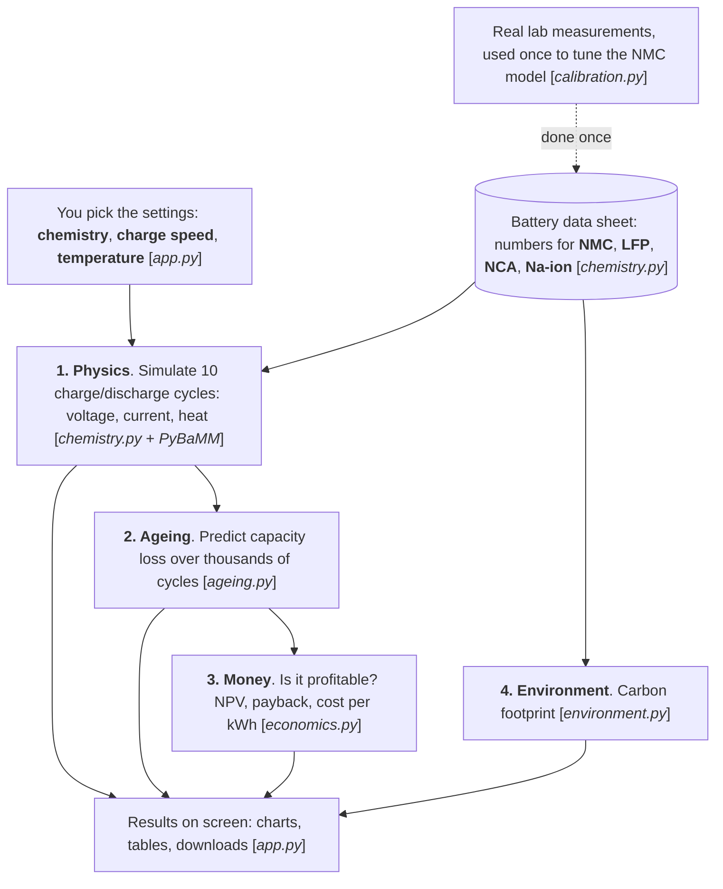

    
   [](https://battery-twin.streamlit.app/)
# Battery Digital Twin

A battery cell simulator that combines a **physics model** (PyBaMM) with **empirical ageing
models fitted to published measurements**, plus techno-economic (TEA) and life-cycle (LCA)
screening, in a Streamlit dashboard. Chemistries: NMC, LFP, NCA and sodium-ion.

## Quick start

```
git clone <this repository>
cd <repository folder>
python -m venv .venv
.venv\Scripts\activate            # Windows   (Linux/macOS: source .venv/bin/activate)
pip install -r requirements.txt
python -m streamlit run app.py    # dashboard
pytest -q                         # tests
```

## How it works

Follow the arrows from top to bottom. Each box is one step, with the file that does it in italics. The dashed arrow is a step done once, not on every run.



## Physics

PyBaMM solves the battery's equations for 10 full cycles. This is accurate but slow, so it only runs a few cycles. PyBaMM simulates full charge/discharge cycles: voltage,
   current, heat and state of charge (SPMe, or DFN above 2C charge).

## Ageing

Formulas fitted to real lab tests take those 10 cycles and project how much capacity is left after thousands more (up to 20,000 cycles). The simulated state-of-charge swing and cell temperature drive an empirical capacity-fade model for that chemistry. Each cycle is followed by a rest so that it lasts as long as in real use (set by "Cycles per year", 365 = once a day), because batteries also age while they sit idle (calendar ageing).

## Money and environment

The ageing curve tells the economics how much energy the battery delivers each year. The carbon footprint only needs the data sheet and pack size. The capacity curve feeds an arbitrage TEA (NPV, IRR, payback, LCOS, second life) cycle by cycle: when capacity drops below the retirement threshold (default 50 %, where the data ends) the battery stops earning and stops costing. A screening LCA gives CO2eq, water and ecotoxicity.

| Chemistry | Physics parameters | Ageing model and data |
|---|---|---|
| NMC | Chen 2020 (LG M50), calibrated to Kirkaldy et al. 2024 | Calendar: NREL BLAST-Lite, LG M50 (Truong Bui et al., IEEE 2021). Cycling, incl. fast/cold charging: fitted to LG HG2 data (Luh & Blank, Sci. Data 2024; Preger et al. 2020; Wittman et al. 2023) and Ohneseit et al. 2025 |
| LFP | Prada 2013 (A123 26650) | NREL BLAST-Lite, Sony-Murata 3 Ah (Naumann et al. 2018, 2020; Gasper et al., JES 2022); cycling term rescaled to Ohneseit et al. 2025; fast-charge factor from Severson et al., Nat. Energy 2019 |
| NCA | Kim 2011 (pouch) | Panasonic NCR18650B: calendar from NREL BLAST-Lite (Keil et al., JES 2016); cycling refitted to Preger et al., JES 2020 |
| Na-ion | Chayambuka 2022 (hard carbon / NVPF) | 0.1 % per cycle (adjustable), commercial NVPF cell (Carter et al., Energies 18, 661, 2025) |

The BLAST-Lite models compute degradation rates from one simulated cycle; because the cycle
repeats, their capacity-loss trajectories are evaluated in closed form (matches BLAST-Lite's
own cycle-by-cycle stepping within 0.0004).

The NCA and NMC cycling terms and the LFP cycling factors are fitted by
`python scripts/fit_ageing.py` to published values in `src/battery_twin/data/published_ageing.csv`
(read from the figures and text of Preger et al. 2020, Wittman et al. 2023, Ohneseit et al.
2025 and Luh & Blank 2024) and `severson2019_cycle_life.csv` (Severson et al. 2019,
Supplementary Table 9; all 124 cells). The raw data files were not used. BLAST-Lite's own NCA
cycling term gave about 5,000 cycles to 80 % where Preger measured about 430 on the same
cell; its NMC term had no depth-of-discharge or charge-rate effect, aged faster when warmer
(the data show the opposite for cycling) and gave about 10x the life at 3C discharge as at 1C.

**Charge rate.** NMC and LFP now age faster with faster charging. NMC also ages faster when
the cell is cold while charging (lithium plating), so cooling matters: a strongly cooled
cell stays colder during fast charging. Discharge rate has no effect for NMC (none was seen
in the data).

## Cooling

The sidebar offers three cooling options. Each sets an average effective heat transfer
coefficient h over the cell surface (a modelling assumption within the textbook ranges of
Incropera et al., Table 1.1; the dashboard shows a warning with the realistic range):

| Option | h (W/m²K) | Pre-conditioning |
|---|---|---|
| Forced air / passive | 25 | No: cells cycle at the ambient temperature |
| Liquid cold plate | 100 | Yes: cells held at 25 °C while cycling |
| Immersion cooling | 300 | Yes: cells held at 25 °C while cycling |

Between cycles the battery always rests at the ambient temperature. The calibrated value
for the Kirkaldy test chamber (13 W/m²K) is still the default of `run_battery_test`. All
published sources are listed in the dashboard's **Sources** tab (`src/battery_twin/sources.py`).

## Validation and known limitations

- **NMC physics** is calibrated to measured LG M50T data (Kirkaldy et al., J. Power Sources
  603, 2024, cycled at 70–85 % state of charge): lithium loss within 0.5 %-points at 28–41 °C;
  2.6 %-points too low at 16 °C (not used in the fit). `python scripts/validate.py`. The
  dashboard shows this comparison under "How accurate is this?".
- **NMC ageing model:** fitted to 24 measured conditions (0–40 °C, 0.33–1.67C charge,
  three labs); typical error x1.4 in cycles to 80 %. It reproduces the main trends:
  5/3C charging at 0 °C fails in about 40 cycles (measured 41), 1C at 25 °C about 300 (282),
  and charging at 40 °C is nearly unaffected by the rate. On the Kirkaldy 70–85 % window
  (not used in the fit) the error is 1.0–1.5 %-points (BLAST-Lite's original: 7–12).
  Worst points: 5/3C at 40 °C (model 395 vs 635), 20–80 % cycling (844 vs 1,650; those cells
  ranged 780–2,150), Wittman's 15 °C cells (303 vs 170). Luh & Blank also show that avoiding
  the bottom 10 % of charge extends life several times; the model's depth-of-discharge term
  cannot capture that. Charging above 5/3C is an extrapolation (the dashboard warns).
- **NCA ageing model** represents the Panasonic NCR18650B: within about 15 % of Preger's
  cycles to 80 % for 8 of 9 tests (0–100 % at 0.5C: 350 vs 240). Newer 21700 NCA cells last
  longer (Ohneseit et al.: about 1,300–1,500 cycles at 20 °C, 1C; model 460). It does not
  capture a late, sudden capacity drop ("knee").
- **Sodium-ion** rests on about 100 measured cycles at C/3; longer runs are extrapolations. The
  0.1 %/cycle comes from the worst of the four commercial sodium-ion cells in Carter et al.; two
  others kept more than 99 % after 100 cycles (< 0.01 %/cycle), and the authors warn against
  generalising from four cells. At 0.1 %/cycle the battery is worn out within about two years of
  daily cycling, so its NPV is negative; the rate can be changed in the sidebar. No
  temperature dependence is applied (Klick et al., Batteries & Supercaps 2025, saw similar fade
  at 25 and 40 °C on another commercial sodium-ion cell). PyBaMM's sodium model is isothermal.
- **LFP** physics (A123) and ageing (Sony-Murata) come from different cells of the same chemistry.
  The Sony-Murata model gave about 8,000 full cycles to 80 %; its cycling term is scaled so
  that 0–100 % cycling at 20 °C and 1C matches the 21700 LFP cell of Ohneseit et al. (about
  1,600; 2C: model 1,590 vs about 1,750). NMC is scaled to the same study, so LFP now lasts
  about 3× longer than NMC (dashboard defaults: about 1,240 vs 370 cycles). Durable cells can
  do much better: Preger's A123 18650 cells reached an estimated 6,400–8,800 (mostly
  extrapolated), so treat LFP life as typical, not best-in-class. Ohneseit's LFP cells also
  showed a sudden drop after about 2,200 cycles, which the model does not capture.
  Fast charging: life is unchanged up to about 2.3C (charge-weighted mean rate) and then
  falls steeply, fitted to Severson's A123 cells (3.6–8C, 30 °C; typical error x1.27 over
  82 cells). Severson's 2017-06-30 batch was left out because the same charging policies
  gave much shorter lives than in the other two batches. There are no data between 0.5 and
  3.6C for this cell, and none for LFP fast charging below 30 °C; the model has no cold-charge
  penalty for LFP, so cold results are optimistic (the dashboard warns below 20 °C).
- **Shaded range:** the capacity chart shows the result for a cell 5 °C cooler and 5 °C hotter
  (lithium) or for the best and worst measured commercial cells, 0.01–0.1 %/cycle (sodium-ion).
  It shows how sensitive the result is to that input, not a statistical confidence interval.
- All curves stop at 50 % capacity, where the data end. The dashboard warns whenever the
  temperature, charge/discharge rate or cycle count is outside the measured conditions. The
  default settings (20 °C, 0.3C charge, 1C discharge) are inside the data for NMC, LFP and NCA.
- **NCA** uses the Kim 2011 parameter set, a small pouch cell (about 1.7 Wh), so a pack needs
  many more cells than with the other chemistries.
- Costs, carbon, water and ecotoxicity factors are indicative assumptions, not sourced data.

## Repository layout

```
app.py                      Streamlit dashboard
src/battery_twin/
    chemistry.py            chemistry table, PyBaMM physics, battery test
    ageing.py               empirical ageing models and validity warnings
    sources.py              all published sources (shown in the Sources tab)
    economics.py            TEA        environment.py   LCA
    calibration.py          NMC physics calibration against Kirkaldy et al. 2024
    data/                   measured data (CC-BY-4.0) and calibration.json, read by chemistry.py
    _vendor/blast_lite/     subset of NREL BLAST-Lite (BSD-3-Clause), patched for NumPy 2
scripts/                    run_single, study_temperature, study_charge_rate,
                            export_csv, calibrate, validate, fit_ageing (outputs go to ./results)
tests/                      pytest suite (physics, ageing, economics, dashboard)
```

## Development

This project was developed with AI assistance (Claude, by Anthropic). The AI wrote most of
the code and helped find and evaluate the published data and models it builds on. I defined
the goals and requirements, chose the direction at each step, ran and tested the code on my
own machine, reported problems and decided which results to keep.

## Licences and credits

Code: MIT (see `LICENSE`). Vendored BLAST-Lite: BSD-3-Clause, © Alliance for Energy
Innovation (NREL), see `src/battery_twin/_vendor/blast_lite/`. Kirkaldy et al. data:
CC-BY-4.0, https://doi.org/10.5281/zenodo.10637534. PyBaMM parameter sets are cited by
name in `chemistry.py`.
